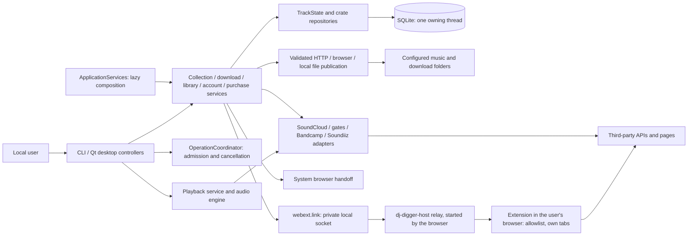

# PROJECT SPECIFICATION — dj-digger

- Status: current implemented system
- Document version: 1.1
- Product version verified: 1.4.0 (working tree)
- Owner: Filip Białogrecki
- Updated: 2026-10-08
- Document lines: <!-- SPEC TOTAL LINES -->2310<!-- END SPEC TOTAL LINES -->
- Section map covers through line: <!-- SPEC MAP LIMIT -->2310<!-- END SPEC MAP LIMIT -->
- Verified against: `pyproject.toml`, `dj_digger/`, `tests/`, `.github/workflows/`, `README.md`, and `CHANGELOG.md`

## Purpose of this file

This file is the durable source of truth for the product and system that are
implemented in the current repository. It records shipped behavior, component
boundaries, interfaces, persistence, security, privacy, integrations, and
verification. It does not contain a roadmap, target design, implementation plan,
or proposed feature. Agents use it to load only the context required by a task.

When this file disagrees with executable code, configuration, or tests, those
artifacts are evidence of the current state and this file must be corrected in
the same change. A behavior that cannot be confirmed in the repository is not an
implemented behavior.

## How to read this file

Never read this document end to end unless the task explicitly requires an
exhaustive audit. Instead:

1. Print only the metadata and generated map:

   ```bash
   python3 scripts/spec_section_map.py --print-map
   ```

2. Select only the sections relevant to the task.
3. Read only the mapped line ranges.
4. For a known endpoint, field, class, environment variable, function, table, or
   collection, use `rg` instead of scanning prose.

The following table is generated from numbered Markdown headings. Explicit
`spec-map-block` markers may expose selected blocks inside an unusually large
subsection; ordinary emphasized text is never promoted into the map.

<!-- BEGIN GENERATED SECTION MAP -->
| § | Section | Lines |
| --- | --- | --- |
| 1 | Specification governance | 116–144 |
| 1.1 | ↳ Authority and scope | 118–130 |
| 1.2 | ↳ Update contract | 131–144 |
| 2 | Product purpose and execution modes | 145–190 |
| 2.1 | ↳ Problem and product boundary | 147–160 |
| 2.2 | ↳ Execution modes | 161–190 |
| 3 | User-visible capabilities | 191–1053 |
| 3.1 | ↳ Track collection | 193–218 |
| 3.2 | ↳ Link classification and exports | 219–237 |
| 3.3 | ↳ Track statuses | 238–248 |
| 3.4 | ↳ Audio preview | 249–420 |
| 3.5 | ↳ Downloads and local-file matching | 421–470 |
| 3.6 | ↳ Store purchase assistance | 471–587 |
| 3.7 | ↳ Local library, analysis and audio export | 588–759 |
| 3.8 | ↳ Qt Quick desktop | 760–1053 |
| 4 | System context and data flow | 1054–1098 |
| 4.1 | ↳ Context diagram | 1056–1082 |
| 4.2 | ↳ Collection-to-library flow | 1083–1098 |
| 5 | Repository layout and component ownership | 1099–1185 |
| 5.1 | ↳ Entry, orchestration, and models | 1101–1112 |
| 5.2 | ↳ Network and external-system adapters | 1113–1144 |
| 5.3 | ↳ Persistence, local media, and UI | 1145–1185 |
| 6 | Runtime architecture and environments | 1186–1329 |
| 6.1 | ↳ Runtime and dependencies | 1188–1216 |
| 6.2 | ↳ Concurrency and lifecycle | 1217–1294 |
| 6.3 | ↳ Local paths and environment variables | 1295–1329 |
| 7 | Data model and persistence | 1330–1441 |
| 7.1 | ↳ Domain objects and identity | 1332–1346 |
| 7.2 | ↳ SQLite schema and invariants | 1347–1399 |
| 7.3 | ↳ Crate persistence and deletion | 1400–1415 |
| 7.4 | ↳ Configuration and credential stores | 1416–1441 |
| 8 | Public interfaces and contracts | 1442–1499 |
| 8.1 | ↳ CLI arguments and exit behavior | 1444–1472 |
| 8.2 | ↳ JSON and CSV summary input | 1473–1488 |
| 8.3 | ↳ URL-opening contract | 1489–1499 |
| 9 | Authentication and authorization | 1500–1566 |
| 9.1 | ↳ SoundCloud authentication | 1502–1533 |
| 9.2 | ↳ Gate action consent | 1534–1566 |
| 10 | External integrations | 1567–1851 |
| 10.1 | ↳ SoundCloud API and media | 1569–1580 |
| 10.2 | ↳ Link hubs and download gates | 1581–1718 |
| 10.2 · block | ↳ ↳ Hypeddit | 1589–1675 |
| 10.2 · block | ↳ ↳ ToneDen | 1677–1701 |
| 10.2 · block | ↳ ↳ Other resolvers | 1703–1711 |
| 10.2 · block | ↳ ↳ Network-write boundary | 1713–1718 |
| 10.3 | ↳ Browsers and clipboard | 1719–1798 |
| 10.4 | ↳ Bandcamp and Beatport carts, Beatport playlists | 1799–1851 |
| 11 | Security requirements and threat model | 1852–2014 |
| 11.1 | ↳ Untrusted URLs and SSRF boundary | 1854–1872 |
| 11.2 | ↳ Secret and personal-data handling | 1873–1888 |
| 11.3 | ↳ File and mutation safety | 1889–1910 |
| 11.4 | ↳ Browser-extension trust boundary | 1911–2014 |
| 12 | Privacy, lifecycle, and retention | 2015–2067 |
| 12.1 | ↳ Data stored locally | 2017–2041 |
| 12.2 | ↳ Data sent to third parties | 2042–2054 |
| 12.3 | ↳ User-controlled deletion | 2055–2067 |
| 13 | Failure behavior and current limitations | 2068–2177 |
| 13.1 | ↳ Error isolation and reporting | 2070–2091 |
| 13.2 | ↳ Confirmed limitations | 2092–2177 |
| 14 | Verification, CI, and release | 2178–2276 |
| 14.1 | ↳ Offline and live test suites | 2180–2228 |
| 14.2 | ↳ Continuous integration and publishing | 2229–2261 |
| 14.3 | ↳ Specification-map verification | 2262–2276 |
| 15 | Evidence and operational references | 2277–2310 |
| 15.1 | ↳ Primary implementation evidence | 2279–2300 |
| 15.2 | ↳ User and historical documentation | 2301–2310 |
<!-- END GENERATED SECTION MAP -->

## 1. Specification governance

### 1.1 Authority and scope

This specification describes the Python package built from `dj_digger/` and the
repository mechanisms that test and publish it. The current product is a local,
terminal-native application. It has no repository-owned server process, public
HTTP service, inbound webhook, message broker, or remotely managed user account
database.

Normative evidence, in descending order, is executable code, test assertions,
packaging and workflow configuration, then current user documentation. Dated
design and implementation documents under `docs/superpowers/` are historical
context and are not evidence that a behavior is present.

### 1.2 Update contract

Any change to product behavior, component ownership, command-line or export
contracts, persistence, external writes, authentication, security, or privacy
must update the affected numbered sections in this file. After editing it, run:

```bash
python3 scripts/spec_section_map.py
python3 scripts/spec_section_map.py --check
```

The generator owns only the generated map and explicitly marked line-count
values. Hand-written content outside those regions is preserved.

## 2. Product purpose and execution modes

### 2.1 Problem and product boundary

`dj-digger` collects tracks behind SoundCloud playlist, user,
collection, and track links, extracts purchase and download destinations, and
presents them as a local playlist. It avoids relying on the finite set of tracks
rendered in a SoundCloud page by using SoundCloud API v2. Saved SoundCloud pages
are not an input.

The application helps the user inspect, open, download, classify, audition, and
remember tracks. Local music can be browsed, analyzed, collected into local
playlists and exported to a folder using documented deck audio profiles. It does
not format USB drives or generate rekordbox libraries. It does not purchase products or complete checkout. Gate and
store behavior is limited to the provider flows described in §§10.2 and 10.4.

### 2.2 Execution modes

The installed entry point is `dj-digger = dj_digger.cli:main`. The following
modes are implemented:

- `dj-digger [target]` assumes the `dig` command. The CLI is headless: it
  collects, exports, persists to the library, and prints a summary table.
  Without a target it exits with "Nothing to dig. Pass a SoundCloud link, or run
  dj-digger-gui to browse."
- `dj-digger dig [target]` accepts a SoundCloud HTTP(S) URL; anything else is
  rejected as not a soundcloud.com link.
- `dj-digger open SUMMARY` reads an exported JSON summary, displays it, and
  always batch-opens its links (prompting for a category unless `--category` is
  given; `--skip`, `--limit` and `--no-open` apply).
- `dj-digger auth ...` manages SoundCloud credentials.
- `dj-digger browser register|unregister` registers or removes the Native
  Messaging host of the browser extension and installs the extension files
  (§10.3).
- `python -m dj_digger` delegates to the same CLI entry point.
- `dj-digger-gui`, installed with the `gui` extra, starts the independent
  PySide6/Qt Quick desktop entry point, the only interactive UI. CLI startup does not import Qt.

The desktop is a local process. Network, disk scan, download, playback preparation,
cart, and batch browser work are process-local background workers rather than a
durable job queue. The desktop and every CLI command hold the same exclusive
data-directory lock (§6.2), so the CLI does not run while the desktop is open.
Download gates, store carts and the SoundCloud browser login drive the user's own
browser through the dj-digger extension (§10.3); the application ships and
downloads no browser.

## 3. User-visible capabilities

### 3.1 Track collection

For SoundCloud URLs, `SoundCloudClient.collect()` resolves the URL and handles:

- users and `/likes`, `/tracks`, or `/reposts` through paginated user endpoints;
- single tracks as one-track playlists;
- playlists/sets by collecting track IDs and hydrating them in batches of 50;
- an optional limit applied to collected tracks.

Hydration restores playlist order because the `/tracks` response is not assumed
to preserve it. Deleted or unavailable tracks omitted by SoundCloud remain
absent. Public API failures are surfaced as `SoundCloudError`; a 404 asks the
user to check the link and, for their own private playlists, to sign in to
SoundCloud first, since requests carry the stored OAuth token. The collection
client can also report the tracks gathered so far after each hydration batch or
page, already in playlist order; the desktop uses this to show an import as it
grows (at most once a second, and always once the declared track count is reached),
and nothing is saved until the whole collection succeeds.

User repost collections use `/stream/users/{id}/reposts`; tracks and likes retain
`/users/{id}/{collection}`. The shared paginator unwraps track entries, preserves
order and duplicates, and rejects repeated next-page URLs rather than reporting
a truncated import as complete. Pagination retains API-host validation and
cancellation checks. HTTP errors identify the failed request without inferring
that every 404 means a private collection.

### 3.2 Link classification and exports

Each track is converted to one or more `LinkRecord` values. Candidate priority is
the structured `purchase_url`, then `extra_links`, then URLs in the description.
At most one link per recognized category is retained. Description links are
restricted to purchase/download categories to avoid collecting general promo
and streaming boilerplate.

The canonical category order is `soundcloud`, `no-link`, `bandcamp`, `beatport`,
`traxsource`, `junodownload`, `apple`, `shop`, `gate`, `smartlink`, `streaming`,
and `others`. Matching uses URL scheme validation and domain boundaries. A free
SoundCloud download is retained even when a store link exists. A track with no
usable link receives a `no-link` record pointing to its SoundCloud page.

Exports are `json`, `csv`, or `none`. JSON groups the compatibility object shape
by category. CSV columns are `category`, `artist`, `title`, `track_url`, and
`shop_link`. The default path is `soundcloud_links.<format>`. Current code reads
JSON summaries; YAML input is rejected with an explicit legacy-format error.

### 3.3 Track statuses

Statuses are `new`, `played`, `opened`, `skip`, and `got`. Starting a track in the
desktop player promotes `new` to `played` (`TrackState.mark_played`, stored in
`track_states` like the others; never over another status). Opening a link promotes
`new` or `played` to `opened`. `played` is not handled: the Unhandled status filter (H) keeps it, and the Status cell reads a muted `Played` so the listening history stays visible. User marks are global by stable track key, so they appear across playlists.
Playlist refresh preserves locally removed track keys, marks newly arrived keys,
and sorts those arrivals above older active tracks while retaining source order
within each group.


### 3.4 Audio preview

Any track with a file on disk (library media, a download or a title-only match)
plays that file in both interfaces; only tracks without one stream from SoundCloud.
Local playback uses FFmpeg to produce 44.1 kHz stereo signed-16 PCM. Decoded
audio is retained in memory, up to 64 MB per source (about six minutes); once
that cap is reached the oldest audio more than 30 s behind the read head is
dropped first. A seek into retained audio moves the read head without a new
decoder; only a seek outside it starts FFmpeg again. A single decoder-control
thread handles repeated seeks; old generations cannot fill the new buffer. Its
underrun is padding the player drops: the device hears silence and the media
position does not advance, while EOF and decoder failures remain distinct. Playback sources hold leases
until their decoder has actually stopped; prefetched files are also protected
from replacement. Local waveforms are generated independently after playback has
started, at most 1024 peaks, and kept in the library (§7.2).
The rendered waveform updates when these peaks arrive; pause and seek do not
discard them, while switching the loaded audio rejects obsolete results.
This playback PCM is never reused for analysis or export.

Playback is included in a normal installation through the core `miniaudio`
dependency. A missing or
unloadable decoder reports a damaged installation and asks for reinstallation,
not a separate audio dependency install.
`resolve_stream()` refetches track metadata. `policy=BLOCK` takes precedence
over `streamable=true` and any transcodings: it reports a SoundCloud account/region
restriction. No returned streams and unsupported stream formats are separate
errors. Non-streamable tracks and snippet-only policy are also rejected.
Resolution prefers a progressive MP3 transcoding and falls back to MP3
HLS when progressive MP3 is absent. It authorizes the chosen transcoding and
returns its protocol, signed URL, duration and artwork URL (SoundCloud's
`-large` image name rewritten to its `-t500x500` size). SoundCloud's own
waveform JSON is not used. Playback
refusals log the numeric track ID, known policy, stream count and reason without
signed URLs or tokens.

The audio worker resolves the stream and opens the HTTP source before handing the
track to the UI thread, so no connection is opened from the interface thread.
The waveform is not fetched before playback: it follows in the background
(§3.8).

Audio is decoded from an HTTP source and is not persisted to disk. A declared
source at or below 50 MiB is buffered progressively in memory; larger or
undeclared sources stream directly. Range requests support seeking. A seek in
an MP3 of known size (a progressive source, or an HLS track once every segment
arrived) opens the decoder at the byte proportional to the target after any
ID3v2 tag, through a view of the source that starts there, instead of letting
miniaudio decode every frame before the target; it takes about a millisecond at
any position and lands within tens of milliseconds on constant-bitrate MP3.
Other sources keep the decoder's frame seek. The output device uses 50 ms
periods. The callback generator decodes 0.4 s ahead of the device (`LOOKAHEAD`)
and hands the device only what it asks for; each decoder read is capped at
16,384 frames, miniaudio's limit. Only real frames enter that queue: a local
source's underrun padding is dropped, an empty queue plays silence, and the
position (`_offset` plus frames handed to the device) advances only with real
audio. Volume and the 10 ms fade-in after every start apply as frames leave the
queue, so a volume change is heard at once. Pause only stops the device, so
resuming continues what it had queued; seek and stop close it and the next play
opens a fresh one, so audio queued from the old position or track never plays
after the jump. The queue lives and dies with its generator.

`beats.py` turns that decoded PCM, before volume scaling, into a kick level of
0-1 every 10 ms (`KickEnergy`), one per track. The light follows this
continuous level rather than yes/no kick decisions, so a missed decision can
never stop it. `KickEnergy.feed(chunk, start)` takes contiguous stereo s16 PCM;
the first call after `seeked()` sets the track time of its first frame. Every
10 ms it takes a 512-point Hann-windowed FFT of the stereo PCM averaged down to
11.025 kHz (46 ms window), combining channel powers without cancelling opposite
stereo phases, and keeps 21-215 Hz (ten bins). Each bin's magnitude is compared
with its median over the surrounding ±12 hops: what holds there (a sustained
bass, its sidechain recovery, a pad) is the reference, and only the residual
above it counts. The level of a hop is then built in four steps:
- **Energy:** the residual summed over 40-130 Hz.
- **Kick-likeness:** the energy is multiplied by a weight from 0.4 to 1, held
  through the next 150 ms of the tail. The floor keeps fills, a filtered kick
  and bass hits visible in proportion to their energy. The weight comes from the
  cosine similarity of the residual's next eight hops to a kick fingerprint,
  ramped:
  - until the track's kick is learned, `GENERIC`, the mean fingerprint of five
    synthetic kicks (plain, 808, clicky, driven, deep) computed at import,
    ramped from 0.45 to 0.8;
  - after that, the track's kick, ramped from 0.6 to 0.85.
- **Loudness:** the weighted energy is compared with the loudest of the last
  few seconds (3 s decay). It is never compared with less than 35 % of the
  loudest of the last half minute (30 s decay), so a breakdown after a drop
  glows dimmer than its kicks, nor with less than a fixed floor, so silence
  stays dark.
- **Curve:** a 10 % knee, then linear, so a low hit shows in proportion to its
  share of the kick's weighted energy.

Each level is timestamped at the window centre less 3 ms, where a kick's level
peaks. It is ready about 0.2 s after its sound (DELAY = 19 hops), well inside
the player's 0.4 s lookahead: through the player, levels reach about 0.18 s
beyond the device position.

The track's kick is learned from onsets:
- An onset is the largest summed rise of the log residual within ±3 hops, at
  least 2.6, from the 13th hop of an analysis on.
- Onsets whose similarity to `GENERIC` is at least 0.6 join a pool of the last
  16. Once five of them match each other at 0.92 or more, their mean becomes
  the track's kick, but only if it drops in pitch: the band's centroid over the
  first two hops at least 10 Hz above that of hops 4-6. A repeated bass note
  matches itself as well as a kick does, but it does not drop in pitch, so a
  bass line never becomes the track's kick.
- An onset at 0.9 or more refines it (a 10 % moving mean). After 4 s without an
  onset at 0.85 or more, a newly formed group may replace it, so a track that
  changes its kick follows within a few bars.

Learning only sharpens the weighting; kicks glow before it. Pads and held subs
stay dark; kicks are the brightest, and other low hits (fills, a filtered kick,
bass stabs, plucked bass) glow dimmer, in proportion.

`KickEnergy` publishes one immutable snapshot of the last 3 s of levels. Its
learned kick and loudness outlive a seek; `seeked()` clears the levels and
restarts the analysis, and a pause retains queued audio and its levels.
`Player.kicks()` returns `(time of the first level, seconds between levels,
levels)`, the levels as plain Python floats (Qt cannot pass a numpy float to
the window), from 0.3 s behind the device position to as far ahead as decoded audio
waits. `Player.heard()` is the track time reaching the speaker, worked out as
follows:
- At every callback the player notes how much it has handed to the device since
  the device started, less the time it has been playing. The median of the last
  32 of these is what still waits in the device's buffers; it is 0.07 s until
  four callbacks have been timed. It is never taken as less than what the last
  callback handed over: a device that waits before its second callback (0.2 s
  on a sleeping PipeWire sink) and every underrun make the measurement read
  low, even negative.
- From the position at the last callback it subtracts that queue and a further
  0.02 s for the audio server's quantum and the sound card, then runs on in
  real time. It never passes the handed position.
- Each device start begins the measurement again. Paused, it is the position.

On PipeWire with 50 ms periods the measured queue is about 50-70 ms.
`services.playback.track_waveform()` returns a track's envelope from the library's
`waveforms` table (§7.2) or computes it from the track's own audio and stores a
non-empty result of 1024 peaks. A local file is decoded by FFmpeg at 4 kHz; a
stream is decoded by `miniaudio` at 4 kHz from the whole file once its buffered
progressive or HLS source reports it complete (`whole()`). A source that does
not hold the whole file (an unbuffered or failed progressive download, a
download restarted by a far seek, a closed source) yields no waveform and
nothing is stored. A local file's row is valid only for its current file
signature; a changed file is decoded again.
`services.playback.remote_artwork()` downloads the artwork URL through the same
SoundCloud-CDN host check and bounded redirects as HLS media, at most 4 MiB,
and keeps up to 64 pictures in process memory only (SoundCloud API terms §5 allow
session caching of user content, not persistent storage).
`local_audio.artwork()` returns the first picture embedded in a local file
(copied out by FFmpeg, at most 16 MiB) or else a `cover`, `folder`, `front` or
`albumart` `.jpg`/`.jpeg`/`.png` file (any case) beside it.

MP3 HLS VOD manifests and each redirect/segment are restricted to HTTPS
SoundCloud CDN subdomains, without credentials in URLs or nonstandard ports.
Segments are fetched in order on a background thread into a seekable in-memory
MP3 buffer, capped at 50 MiB; oversized streams fail explicitly. Manifests are
capped at 1 MiB and 10,000 segments. Incomplete, encrypted, master, byte-range
and non-MP3 container playlists are refused. Transfer failures remain errors,
not successful EOF; closing releases the response and stops further requests.

The next visible track is prepared during the last 20 seconds of playback. A
filter change discards preparation that no longer matches the next row. Tracks
advance automatically at end of stream. Playback follows the selected playlist
occurrence, so repeated track IDs advance past their own row instead of looping
back to the first occurrence. Missing `miniaudio`, an unavailable
audio device, a backend that refuses to start or stop an open device, bad media,
or a missing track ID produces a user-visible degraded state rather than
terminating the application. A device that fails after having worked is closed and
rebuilt on the next attempt rather than disabling playback for the session.
Decoder EOF and failures become generation-tagged playback events inside the
audio callback once the queued lookahead has played out, so neither escapes
through CFFI and the end of a track is never cut. Events from a generator made
stale by stop, seek, unload, or a new load are ignored. At the end of the visible
list the final track stays loaded; pressing play again starts it from the beginning.

### 3.5 Downloads and local-file matching

The selected track or all eligible visible tracks download into a playlist-named
subfolder of the configured directory in the desktop. It uses
`paths.playlist_download_directory`: expand `~`, replace invalid filename
characters, collapse whitespace, trim dots/spaces, and limit the
folder name to 120 characters. A blank title uses the configured directory;
an already matching final directory name is reused case-insensitively. The
destination is captured for the operation, including gate completion and copies
of existing local files. Resolution priority is a selected gate, an explicit
artist download URL, then the authenticated SoundCloud download endpoint.
Finished files are atomically renamed from a `.part` file to a sanitized,
collision-free filename. Recognized suffixes are MP3, WAV, FLAC, AIFF/AIF, and
ZIP. HTML responses are rejected as files, redirect hops are bounded at five,
and the maximum body size is 2 GiB.

Batch downloads use at most eight worker threads. Each gate flow uses its own HTTP
session because cookies are flow state. Prerequisites such as a real profile,
SoundCloud login, or Hypeddit and ToneDen browser completion are collected and retried
at most once by the desktop flow. A file finished in the user's browser is copied
out of the browser's download folder through the same validation and then deleted
there (§10.2). Completed downloads store their local path and mark
the track `got`. While a batch runs, each row shows its own state in the desktop:
the transfer's progress, a half bar while it is handed to the browser pass or a
prerequisite, a full bar once its file is in, and no bar with "✗ Failed" in its Status cell when it failed;
a gate whose page answers 404 or 410 fails at once with "the gate page no longer exists" and is
never handed to the browser or asked about;
statuses are refreshed when the batch ends. No browser window or tab appears for
a gate unless the user opens one (§10.2). A batch with failed rows, or rows it
handed on and never started (more gates than one browser batch takes), ends in a
"Download results" screen listing each with a plain reason from its failure group
(needs a sign-in on the gate site, a CAPTCHA solved, a step only you can do, the gate
refused or is gone, timed out, the download failed, needs a SoundCloud sign-in or your
name and email, not started) followed by the original message, wrapped: Retry these runs them
again, Open in browser opens each one's gate (or its SoundCloud page),
and, when the browser pass was needed and no extension is connected, Connect browser
and retry shows the Connect browser dialog (§3.8) first; Close ends the download. The
default button is Open in browser when any row needs a person, else Retry these. Skipping
the Settings or sign-in step a prerequisite asks for skips only those rows, which then
appear in the results with that reason; Stop download ends the whole download.

The local scanner recursively indexes configured directories for MP3, WAV, FLAC,
AIFF, M4A, AAC, OGG, and ALAC files, following symbolic links, and caches path,
modification time, size, and normalized filename data in SQLite in batches of
200 rows per transaction. Automatic scans log inaccessible folders at DEBUG level
without an error banner; explicit explorer access reports errors. Cancellation
stops the walk between files while keeping what was already written. Artist-plus-title matches are confident and
may set `got`; title-only matches require at least six normalized characters and
only attach a path: both interfaces show it and preview that file locally, and
Download never treats it as an owned file. A unique filename may contain extra text around the matched
artist/title, such as a mix label; ambiguous decorated matches are rejected.
Missing files are removed only after a complete readable parent listing on the
known volume; inaccessible or replaced roots retain their records. Directory
inode/device tracking prevents symlink cycles. Only file-provenance `got` marks
are eligible for clearing.

### 3.6 Store purchase assistance

Store assistance is explicitly initiated by the user. Bandcamp uses verified
cart automation; Beatport uses the same verified cart when the browser is signed in
to Beatport with an exact track ID and otherwise produces a playlist for a supported
transfer. The application never logs in to either store. The work runs in the user's own
browser through the extension (§10.3). The desktop owns one lazy background
session of it for its lifetime: product discovery, revalidation and mutation run
in at most two inactive tabs of the user's own last focused browser window, so no
window appears, nothing is brought forward and the user's current tab stays
active (a browser without any window gets one new window, closed with the
session). The only automatic visible effect is the end of a batch: one cart tab
per store with verified items is made active and handed over to the user, who
reviews and checks out there; the extension no longer owns, guards or closes that
tab. Items to finish by hand open as tabs only when the user picks that on the
result screen. There is no second browser, cookie copy, application-owned profile
or store login: the browser's own Bandcamp and Beatport sessions are used as they
are, and Bandcamp cart continuity depends on the browser's cookie jar (a guest
cart needs no account login). When no extension is connected, the batch stops and
the desktop shows the Connect browser dialog (§3.8) before retrying.
`P` opens every exact Beatport track page among the targeted rows in the
configured regular browser (release links are counted and skipped), with the
same confirmation threshold as bulk open. With no store filter, Bandcamp is preferred and Beatport is the
business-level fallback. When both filters are explicitly active, the desktop emits independent
requests so a successful Bandcamp addition does not remove that track from the
Beatport playlist.

Two asynchronous page workers preflight a batch. They resolve an exact product,
check individual availability and price, and verify current cart membership. The
desktop adds the plan without a review screen (a cart is not a purchase; the cart
tab is the review). A Bandcamp name-your-price item goes in at its verified
minimum, or at the price the artist suggests when the `nyp_price` setting says
`suggested` and that price is higher (§7.4); an item whose minimum is zero and that
declares no positive price is reported, not added. A canonical
Beatport `/track/<slug>/<numeric-id>` link is exact by its ID and is read on its own
page; a release link is read in the user's browser and the track is matched in
its page code (never by searching Beatport by artist and title). Beatport reads
its price, version and artists from the page's server-rendered data (`__NEXT_DATA__`),
which is there before the page hydrates and keeps the price once the track is in the
cart, and from the add control's label (`Add track 'T' (Mix) by A to cart. Price:
$1.49`); it takes the control of that product's own row or, on a track page, the main
control outside the recommendation rows. A control reading `Track 'T' is already in
your cart` marks the item as already in the cart; otherwise the cart page decides
(`/cart` moves on to `/cart/cart/<id>` client-side, the rows render after the header
counter), telling a real cart row (one with a "Move to cart" control) from a
recommendation. Not being signed in
(`/cart` redirects to the home page), a security challenge, or no exact ID in the
page code makes the item a playlist entry that keeps an exact track URL when there
is one, with artist/title metadata otherwise.

Before each mutation the page is reloaded and product identity and price are
compared with the preflight snapshot. Ambiguous matches, version mismatch,
changed price or product identity, unavailable controls, external redirects, or
failed cart verification skip or fail the affected item. An add is not retried
when its verification is uncertain. Beatport's header hydrates showing "0 items" and
loads the account's cart a moment later, and a click before that does nothing, so a
Beatport counter is trusted only once it has held for two seconds (at most ten): the
add waits for it, an item the settled page marks as in the cart is not clicked, and
the cart check reads it too. Beatport verification reads the header cart counter
(5 s), then the cart page (25 s), inside the same 45-second budget. When Beatport
answers the click with its "previously purchased ... repurchase it again?" question,
its Cancel is pressed and the item is skipped as already bought on that account
(never added again).
Bandcamp verification runs three stages on
their own clocks (the cart count for 5 s, the real side-cart control requiring a
visible removable row with the same canonical host and path for 10 s, one
reload check for 25 s) inside a 45-second budget, and an unverified result names
the stage it gave up at. An unverified click or a structural failure saves a
screenshot and a redacted page copy (script bodies and query strings removed)
under `cart-diagnostics` in the data directory, keeping the last ten (the page copy
also has e-mail addresses removed and is omitted when the page exceeds 2,000,000
bytes; the screenshot is best effort and never taken in a background tab). After two
unverified clicks in one store the batch stops clicking and reports the rest as
uncertain. "Finish in browser" on the result screen opens those products with Buy
expanded and the price filled, the desktop asks the user to press Add to cart
themselves, and one read-only cart check per item records `manual` or a manual
failure (Beatport pages are opened as they are; there is nothing to expand). A user-raised price is filled into Bandcamp's current price input
or fails before the add click; it is never silently discarded. A still-uncertain
page remains open for manual inspection. The flow leaves verified carts open for
the user while releasing the batch worker for another request; a failure to
show the final cart window is reported as a warning and never discards the
verified additions. Mutation is serial within each store,
cancellation after a click waits for one bounded verification, and repeated
structural failures open a per-store circuit breaker without
navigating the rest of the queue. Results group identical root causes and mark
only failures that are safe to retry. The result screen counts what was added and
lists every targeted track that was not: a ticked track without any Bandcamp or
Beatport link is reported as such (it is never dropped silently), as are tracks not
found, ambiguous, unavailable or failed. "Open the links that were not added in the
browser" opens, for each, its store link (or the failing result's URL), else the
track's purchase link, else its SoundCloud page, in the configured regular browser.
"Show carts in browser" opens fresh cart tabs of the last batch's stores. Beatport items that could not be put in the cart (not signed in, challenge, no
exact ID) and safe Beatport lookup fallbacks are reported as playlist-ready, not
as cart failures; the result log shows "in Beatport cart" apart from "to playlist". The
result action writes a new, non-overwriting plain-text playlist in the playlist's
download folder and copies its entries to the clipboard. It also sends the
accepted titles and artists, with Beatport preset as the destination, to
Soundiiz's public playlist-import endpoint and opens the returned HTTPS review
URL in the configured regular browser. The response URL must remain on
`soundiiz.com/go/import-playlist/`; imports are limited to Soundiiz's documented
1–200 tracks. Above 200 no request is sent; the saved playlist file remains and the
limit is reported apart from other import failures. Promo prefixes, uploader names, preview markers, trailing label
fields, and `OUT NOW` markers are removed from SoundCloud metadata when its title
contains an explicit `artist - title` pair, including missing whitespace around
the separator. Featured performers and remixers named in the cleaned metadata
are also sent as Soundiiz artists to improve catalog matching. Exact Beatport
URLs are written to the local file when
known and replace that track's stored Beatport release link in the current
playlist; release and label URLs are never persisted as exact matches. Other
rows use the cleaned `artist - title`. Match review, transfer approval, payment,
and checkout remain manual.

Cart results translate internal statuses into readable labels while preserving
machine-readable status/reason codes. Unknown statuses remain explicitly unknown.
The result table is sized to the batch and available height, with actions in a
two-column grid; track labels and reasons are rendered as literal text.

### 3.7 Local library, analysis and audio export

The desktop sidebar (§3.8) lists playlists above a lazy folder explorer in one
scrolling panel. A folder opens as 250-file pages; previous/next page controls
appear under the sidebar only for folders above one page.
Names load before metadata; no audio analysis or content hashing
runs just because a directory is opened.
Local rows do not require a `LinkRecord`. `ctrl+l` creates/appends a local playlist.
A local track's name is its file name on disk without the extension, never a tag
title. Its artist is, in order, the one set by hand (`manual_json` `artist`), the
file's artist tag, or the text before the first ` - ` of the file name unless that
is only digits (`local_library.filename_artist`). Once a file was inspected, its genre
comes from the `genre` tag, its year from the first of `date`, `year`, `originaldate`,
`original_year` that starts with a year from 1900 to 2100, and its label from `label`,
`publisher` (ID3 TPUB) or `organization`. Audio files are `.wav`, `.aif`, `.aiff`,
`.mp3`, `.flac`, `.fla`, `.m4a` and `.aac`; `.mp4` is left out as video. `LocalLibrary.rename` gives a file
a new name in its folder and keeps its extension: the name must be one visible path
component of at most 240 UTF-8 bytes; symbolic links, files changed since they were
indexed and files the player has loaded or prefetched are refused; the rename never
replaces a file (a hard link that fails on an existing name, then unlink; on disks
without hard links an existence check before `os.rename`). `Database.rename_media`
moves the record's path and signature and carries the analysis, the cached waveform,
`track_local_files` provenance and crate `local_path` values along.
Automatic scans skip inaccessible folders without an error banner; explicitly
opening an inaccessible folder reports the access error.
The clickable footer switches to local actions for folder/local-playlist views:
Convert, Analyze BPM/key, Analyze folder, Play, Remove, Select and Edit BPM/key, with secondary actions
omitted when space is limited. The store legend and shop commands are hidden in
this context; SoundCloud views restore them. Stop appears during an operation.

Clicking Analyze BPM/key (or `j`) immediately analyzes the selected local files,
or the highlighted file when none are selected. `Shift+J` / Analyze folder covers
all immediate audio files in the open folder, ignoring selection, filters and
pagination; it does not recurse into subfolders. No analysis confirmation is shown.
The BPM/key edit dialog shows the independently resolved source for each field:
Manual, Analysis (estimate), File tag or Not available. It shares value-resolution
logic with local row hydration and ignores analysis from a different file
signature. Sources remain presentation data, outside serialized Track values.
The dialog loads through the application IO worker and ignores stale view results.

Local folder and local-playlist views always show BPM and Key, including stored
results on first opening without reanalysis. This does not change the optional
column preferences used by SoundCloud views. Starting analysis checks for the optional
analysis dependency and FFmpeg before starting. Missing dependencies produce an
installation hint rather than repeated failures for each track.
Analysis uses optional librosa in one fresh Python subprocess with explicit pipes
and bounded JSON output. It does not inherit multiprocessing resource-tracker
descriptors from the host process's captured stderr. Cancellation terminates and reaps the
analysis process group, including FFmpeg, before deleting its temporary workspace.
The algorithm uses continuous
FFmpeg resampling and overlapping STFT frames (`center=False` semantics), one
global onset envelope and aggregated chroma. Channel powers are combined before
feature aggregation to avoid anti-phase cancellation. Feature envelopes use a
temporary disk file rather than keeping decoded audio in RAM. Automatic results
are estimates; no confidence percentage is claimed. `ctrl+k` edits BPM/key and
supports tempo ×2/÷2 plus classical/Camelot choices. Manual values, current
analysis, and source tags are stored separately with that priority. Cache checks
include file signature, SHA-256, algorithm version and parameters. Audio tags and
rekordbox data are never written by analysis.
Results include separate missing-key and missing-tempo reason codes. Analysis
version `onset-chroma-2` invalidates older cache entries when analysis is requested
so these reasons can be recomputed. Per-file errors retain the analyzer traceback
in the diagnostic log. Missing BPM/key results also log their per-file reason at
INFO level. Completion shows a short notification with keys found, no clear key,
and processing errors, without opening a summary panel. A private JSONL file is
streamed during work, then atomically replaces `last-analysis.jsonl` in the default
log directory; cancelled/failed runs retain completed rows and their termination
status. Report publication failure retains the previous report and is reported
explicitly. No-key results are not counted as processing errors. Manual corrections
remain independent of automatic results recorded in the diagnostic file.

In an explorer folder, `x` / Remove asks for confirmation with the selected file
paths (or the highlighted file) and permanently deletes those files from disk.
A folder page shows one row per file: a symbolic link to a file on the same page
folds into that file's row. The page shows at once from the media index; only files
never probed (no stored duration) are then inspected with ffprobe, and their tags
update the existing rows in place. A selected symbolic link is refused before confirmation;
every confirmed file is revalidated before any is deleted, so a changed file or
loaded/prefetched audio stops the batch with nothing removed. Deletion
marks central media records unavailable and clears cached file mappings, while
preserving playlist references and manual metadata. A database failure after
unlink is reported explicitly; filesystem and database updates are not atomic.
In saved playlists, Remove retains its existing playlist-only, undoable behavior.

Convert (`ctrl+e`) asks which decks the files must play on, plus the destination,
then constructs a frozen export plan and shows a review before execution. The
format is not chosen by hand: `decks.best_profile()` picks FLAC when every chosen
deck reads FLAC and WAV otherwise, capped at the highest bit depth and sampling
rate all chosen decks list for PCM (for example FLAC up to 24 bit/96 kHz for
CDJ-3000 with OPUS-QUAD, FLAC up to 48 kHz once an XDJ-XZ joins, WAV up to 16
bit/44.1 kHz with an XDJ-AERO). Decks that play exactly the same files (the
same MP3, AAC and PCM rates, bit depths, lossless codecs and MPEG-2 AAC rule;
file systems may differ) share one box, `decks.DECK_GROUPS`, ten groups laid
out two to a row; ticking one chooses all its decks, and a group starts ticked
when any of its decks was chosen before. The dialog shows the resulting format
as groups are ticked and needs at least one. The chosen decks are remembered as
`export_decks` in the shared configuration and saved in the plan, so resumed
plans and their reports keep them; before a choice is saved, and for plans saved
before this, the set is CDJ-350, 850/850-K, 2000, 2000NXS, 2000NXS2, 3000 and
3000X. Exports copy every selected audio
file to a unique new folder, including unchanged files. An unselected folder view
covers all matching pages; recursion is explicit. A file is kept as it is only
when every chosen deck plays it according to the rules below; PCM and, for a FLAC
target, FLAC/ALAC otherwise convert to the target, while a lossy file some chosen
deck cannot play is listed as an exception rather than transcoded. Only necessary
conversions run.
No automatic upsampling, downmix or normalization is performed. Nonstandard
sample rates, ambiguous streams, clipping and unsupported parameters are reported
as exceptions. Known text metadata is preserved where the output muxer supports
it; supported FLAC artwork is copied, other omitted metadata is reported.

Versioned rules (`RULE_VERSION`; a plan made under other rules must be prepared
again) transcribe the USB playable-file tables of the operating instructions, each
deck citing its manual in `decks.SOURCES`: CDJ-350, 850/850-K, 900, 2000, 900NXS,
2000NXS, 2000NXS2, TOUR1, 3000 and 3000X; XDJ-700, 1000, 1000MK2 and AERO; and the
all-in-one XDJ-RX, RX2, RR, XZ, RX3, OPUS-QUAD, XDJ-AZ, OMNIS-DUO and XDJ-AN. Per
deck they hold the MP3 and AAC LC sampling rates (MPEG-2 Layer-3 at 16-24 kHz with
8-160 kbps from the CDJ-900 on and on the XDJ players; no 32 kHz on the CDJ-3000
generation and the newest all-in-ones; 44.1 kHz only on the XDJ-AERO), the PCM
rates and bit depths, and which of FLAC and ALAC are read. The CDJ-350, 850, 900,
2000 and XDJ-AERO list MPEG-4 AAC LC only, so a raw ADTS `.aac` file, which may be
MPEG-2 AAC, is unverified on them. A file outside a table is incompatible because
it is not documented, not because it was tested. The rules also hold each deck's
USB file systems (FAT16/FAT32 on all, HFS+ on all but the XDJ-RX, exFAT only on
the CDJ-3000X, XDJ-RX3, OPUS-QUAD, XDJ-AZ, OMNIS-DUO and XDJ-AN, NTFS on none) and
the eight folder levels every manual shows. Planning finds the mount point of the
destination and its file system (`/proc/self/mounts` on Linux, `stat -f %T` on
macOS, `GetVolumeInformationW` on Windows); when it is FAT, exFAT, HFS+ or NTFS
the plan carries warnings, shown in both reviews without blocking, for chosen
decks that cannot read that file system and for planned files more than eight
folders below the drive root. Other or undetectable file systems, such as an
internal disk, produce no warning.
Both profile compatibility and actual-set compatibility distinguish documented
compatible, incompatible and unverified files. These are audio rules, not proof
of device testing or of USB filesystem support. WAV output is canonical RIFF PCM
with checked chunk sizes, alignment and sample identity for lossless transforms.
New files undergo full decoding and length/parameter verification; copies also
undergo byte hashing. Classic RIFF and FAT32 file-size limits are enforced.

Export options keep Review/Cancel outside scrolling content. Review names the
target format and shows actual-set compatibility for the chosen decks only, and keeps
Execute/Cancel plus the replacement warning visible. Button handlers accept only
the explicit primary action; Cancel/Escape never authorize execution. The first
200 plan entries remain visible with the complete report available separately.

Replacement is never a remembered default. A durable per-file journal records
preparation, temporary-original preservation, installation, database commit and
cleanup. Installation uses platform-exclusive rename rather than overwriting
foreign files. Symbolic/hard links and playback leases prevent replacement.
Cancellation is cooperative during preparation and between files; commit settles
without interruption. Startup recovery compares content hashes, completes or
restores unambiguous states and preserves ambiguous ones. Successful replacement
leaves no lasting backup. Directory fsync is used where supported; this is not a
cross-filesystem transaction or guarantee against storage power loss. New-folder
exports keep partial results and a complete report; `ctrl+u` resumes the most
recent unfinished operation from the application's trusted SQLite journal.

`i` imports playlists created by a SoundCloud profile independently of
profile-track digging. The profile link is normalised by `profile_url()`: a scheme
may be missing, the host must be exactly `soundcloud.com`, `www.` or `m.` (so not
`on.soundcloud.com` short links or look-alike hosts), and only the first path segment
(`[A-Za-z0-9_-]+`) is kept, dropping `/sets`, query strings and fragments; it is resolved
through the API host only. All pages of `/users/{id}/playlists` (200 per page, the sets the
profile created; liked and reposted sets are not requested) are read before the first save, so
progress reports done/total. A listed set owned by another user is skipped ("created by someone
else"), a private one is skipped unless private mode is on, and a set SoundCloud cannot serve is
reported as failed while the rest go on; a changed session or cancellation still stops the
whole import. Every report entry carries the set's title.
Private mode checks `/me` ownership and session identity.
Pagination detects repeated cursors; track hydration is batched with a bounded
cache and preserves duplicates/order. Missing tracks or incomplete replies retain
the previous snapshot. Provider playlist IDs preserve identity across permalink
changes; local deletion generations suppress stale results. Mass import performs
no external gate/hub resolution.

### 3.8 Qt Quick desktop

The optional desktop uses PySide6 and a QML `ApplicationWindow`. The
playlist/folder sidebar spans the full window height; the waveform and transport
sit above the virtualized track table beside it. Status is the first table column, and the BPM/key columns
appear only in local views. Transport buttons use SVG icons with accessible labels and tooltips. The window icon is the packaged application icon (`gui/qml/icons/app.png`, 256 px: a record carrying an artwork-style barcode seeded from `dj-digger`, with a white label, on a blue-to-bordeaux tile; `scripts/app_icon.py` draws it and writes the same design to the Windows `.ico` and macOS `.icns`), so the title bar and taskbar show it alongside the executable's shortcut icon. The desktop file name (the Wayland app_id) is `dj-digger`, so a Linux desktop entry named `dj-digger.desktop` supplies the dock name and icon of the open window; the repository does not ship that entry. The desktop waveform rises
from the bottom edge of its panel, never mirrored, filling the space down to the
transport row; the desktop uses the same averaged, normalized envelope and
level curve in `waveform.py`. Desktop bars share one vertical gradient from the
first to the second resting colour of the colour pair chosen in View → Colours,
bottom to top of the panel; the unplayed layer
draws it with reduced opacity (0.38 dark theme, 0.45 light theme), and a 2 px
playhead in the foreground colour is placed at subpixel precision. While a track plays, a 25 ms backend tick sends a
small audio snapshot and, when it differs from the last one sent, a `kicks` event (key, start, step, levels) containing the
kick levels around the device position, including those decoded but not yet heard. The snapshot carries `heard`, the
track time reaching the speaker (`Player.heard()`), and `at`, the epoch time it was taken. Table cells and transport state bind to the
bridge's `audioKey` and `playing`, which change only when the track or play state does, and the waveform bar levels
are recomputed only when the bar count (one per 3 px) changes; bar canvases repaint 50 ms after a resize settles.
The window shows these as they are heard:
- Clock: it starts from the snapshot's `heard`, advanced by the time since
  `at`, so delivery delay does not make the light late. It runs in real time
  between snapshots, never past the latest snapshot position; smaller
  differences ease by a quarter, and one over 150 ms re-anchors it. There is
  no delay setting. While a track plays with animations on, each frame also
  moves the playhead to heard audio, so it slides instead of stepping with the
  snapshots; paused, or with animations off, it shows the snapshot position.
- Light: a `FrameAnimation` calls `pulseTick`, which samples the kick level
  40 ms after heard audio (`displayLead`), interpolating between the 10 ms
  levels, because a computed frame reaches the eye two or three frames later
  (scene graph, compositor, monitor); levels of another track count as 0. A `flash` scalar (0-1) jumps up to the level at once and
  otherwise dies away like a lamp, exponentially with a 75 ms time constant
  (`decay`); `glow`, which drives every light, is `flash` above a 15 % gate
  rescaled to 0-1, since even a faint neon tint reads as light, so a full kick
  is dark again within 150 ms. So every kick shows in proportion, softer low
  hits show dimmer and shorter, and the light goes out between kicks even at
  174 BPM. A new track or a jump over 0.5 s clears it; a re-anchor alone does
  not.
- The waveform and the artwork keep their base colours at rest, including while
  paused, and the unplayed region never pulses. With a kick the whole played
  side, every bar left of the cursor, fades in to `flash` in the same gradient
  in neon: a full-width neon copy of the bars, painted once per waveform, colour
  pair and size, clipped with the played bars at the cursor.
  Where the scene graph runs on the GPU, a `MultiEffect` (`QtQuick.Effects`)
  adds a glow around those bars, a zero-offset shadow in the pair's second neon colour; the
  software renderer runs no shaders, so there the colour alone carries the
  kick. The cursor tints toward that neon colour with `flash`. On the dark theme
  each neon colour is over twice as bright as its resting colour, so a kick
  reads as light rather than a change of hue (a lighter pastel rest read as lit,
  and the kick as the light going out), and both are saturated, rest at least
  0.7 and neon at least 0.8 HSV saturation, not pastel; on the light theme the
  neon is the more vivid. No waveform colour is a saturated red (linear R ≥ 80 % of R+G+B), and
  the resting colours keep 3:1 against the panel and
  window background; the offline GUI test asserts these for every pair in both themes. The artwork backdrop crossfades toward peak colours
  that keep the hue with saturation + 0.3 and lightness + 0.06 (dark theme)
  or + 0.08 (light theme); a red (linear R ≥ 70 % of R+G+B, the bordeaux
  tones) only lightens, by 0.02 (dark) or 0.03 (light). When that step would
  raise relative luminance by more than 0.08 (bright greens, yellows, cyans),
  the saturation and lightness steps are scaled back by 0.08 / gain. Each backdrop tone's
  base/peak pair stays under the WCAG 2.3.1 general flash threshold (relative
  luminance change below 0.1) and red flash threshold (red value change below
  20); the offline GUI test asserts both for every pair in both themes.
- Disabling animations stops flashes and clears the clock.

The loaded track fills a Now playing header in the player panel: a large title,
beneath it the artist followed directly by the BPM and key chips, and generated artwork: a record on a backdrop
that is always the two resting colours of the chosen pair, laid out from a hash
of the track key by a seeded generator (mulberry32): a linear blend at a random
angle, each end held for a random stretch, plus a radial pool of one of the two
colours at a random spot, so tracks differ only in layout. It is painted on a
`Canvas` once per track, pair, theme and size; the kick layer is a second
canvas with the same layout in the peak colours. The record is a flat near-black
(`#0c0c0e`) with a label in one of the two colours (chosen by the hash) darkened by 25 %; the record never
pulses. The label carries the track's artwork when there is one (SoundCloud
artwork, or a local file's embedded or folder picture), else the default cover
chosen in Settings, else stays the plain tone. The backend cuts the picture's
centre square to a 256 px circle (`gui/artwork.py`, QImage on the worker, no
shader) and sends it as a PNG data URL in an `artwork` event (key, image) after
playback has started; its colours are not altered and nothing is drawn over it.
It turns with the record and fades in (300 ms) when it loads; artwork of any
other track is ignored and the picture is cleared when another track loads. Its
surface carries a barcode of the track: 18 to 27 radial marks spread evenly
around the record, each placed at random within its own slot, spanning the
whole groove, its inner or outer half, its middle, or its thirds with a gap,
with dots, laid out by a seeded generator so a track always draws the same code. The record turns
while the track plays; with the kick light the backdrop crossfades toward its
peak colours. The backdrop is never dimmed. The artwork is hidden when the panel is narrower
than 640 px. These
details arrive in a separate `nowPlaying` event when a track loads or its rows
refresh (for example after analysis or an edit), not in the position snapshots.
The palette is near-black (light theme: silver-grey) with an electric-blue
accent, a bordeaux second accent and silver secondary text. Selected rows,
playlists and folders use a soft low-chroma blue (dark `#34466f` with white
text, light `#b8c9f0` with near-black text, distinct from both zebra row colours), and chips on a selected row sit
on the panel colour; clocks, BPM and
counts use tabular digits. In local views BPM and key render as chips; BPM shows
one decimal place when fractional. Keys are parsed from common spellings (`Am`,
`A minor`, `Amin`, `8A`, enharmonic sharps/flats) by `analysis.key_names`, shown
in Camelot or classic notation (View → Key notation, default Camelot), sorted
around the Camelot wheel with unrecognised keys last, and tinted with one of
twelve wheel hues 30° apart in OKLCH (lightness 0.70, chroma 0.15, 1 at 180°),
lighter for B keys. A key chip is ringed in the text colour, never a key hue, when it mixes harmonically with the
playing track (same key, one step around the wheel, or the relative
major/minor) and a BPM chip when it is within 3 % of the playing tempo; the
playing row itself is never ringed.
Motion is on by default and View → Animations turns all of it off: rows fade to
a hover surface; a status change other than to `played` flashes its rows (success colour for owned,
muted for skipped, accent otherwise; not for more than 100 rows at once, and also after a sort or
filter rebuilt the rows); download fills carry a sweeping highlight only while
an operation runs; the play button pops when its icon changes. The player panel
keeps its full height from startup: with nothing loaded the record stands on the
pair's colours with a white label and no code, the waveform shows the loading noise
drifting about eight times slower, with no cursor, seeking or hover time, and the
transport row asks to select a track. The volume slider fills a 4 px track with the
pair's rest colours, foot to top across the whole track, and has a 12 px knob in the
text colour (14 px while hovered or dragged). Moving bars (the noise and the blends into and
out of it) advance on every displayed frame by that frame's duration and are drawn
as GPU-batched rectangles: the rest gradient at the unplayed opacity under panel-coloured
covers above each bar and in its gap, heights set once per frame in whole device
pixels from per-bar constants computed once per bar count; the canvas paints only the
settled waveform; the played and kick layers stay hidden until the bars settle and are then
painted again. The motion stops while minimized, and the idle drift also rests
while the window is not active. Until the loaded track's waveform
event arrives the artwork shows a white backdrop and label on a blank record and the bars flicker as
noise, each rising and falling with its own random range, speed and phase, unrelated to its neighbours
(about 30 repaints a second of the unplayed layer only). A track change scatters the bars on screen into
that noise (450 ms); when the waveform arrives the bars settle from their current heights into the envelope (700 ms) while the key colours and the record code fade in
(600 ms). Without animations the placeholder stands still and both switch at once. The waveform and artwork keep their base colours, and the kick light
is part of this motion. Theme changes and recycled table delegates
are not animated. Space always belongs to playback, wherever focus
is, except while typing in a text field or inside a modal dialog: while a track
is loaded it only pauses or resumes that track, whatever is selected; with nothing
loaded (at startup or after Stop) it starts the selected track. Enter in the track
list starts the selected track (double click too). The transport Play button
follows Space, and its icon/label show Pause exactly while the loaded track plays. The read-only folder explorer starts with the system Downloads and
Music locations from `QStandardPaths`, plus previously saved additional folders.
The home directory is not a default root. “Add folder…” (also Ctrl+O) validates,
saves, and opens a chosen directory using `pinned_directories`; duplicates are
shown only once. Each root has a native Qt `TreeView` backed by the shared `gui/directories.py` `DirectoryModel`/`QFileSystemModel`
through `MusicFolders`, a filter proxy that lists only folders holding audio (the formats and partial-file rule of the folder page) in them or below them.
Two worker threads check each folder breadth-first, skipping dot entries and symbolic links and giving up as "no music" after 20000 entries;
a folder shows once its check finds audio, folders without music of their own are checked again every 30 s, and roots and the folders above them always show.
The check tells a folder holding audio itself from one whose audio is only in folders below it. A row's chevron folds and unfolds
its subfolders; clicking its name (or Enter on the focused row) opens the folder, and a folder of the second kind also unfolds,
never folds, its subfolders. Right-clicking a root or tree row, the Menu key, or a press held on a touch screen (which then does
not open the folder) opens a menu acting on that folder, whatever view is loaded: Open, Analyze folder (its immediate audio files,
§3.7), Rescan (checks it and the folders below it for music again, each keeping its place until its answer arrives, and reloads
it when it is the open folder), Show in file manager (§8.3), Copy path, Pin folder or, for a pinned folder, Unpin folder (which
takes a pinned root off the list), and Hide folder. A hidden folder, root or not, is saved in `hidden_directories` and leaves the
tree with everything below it; the Folders section menu lists the hidden folders under Hidden folders, and choosing one shows it
again (Settings → Preferences → Hidden folders still edits the list, one per line). Folders dropped on the Folders section from a
file manager are added as Add folder… adds them.

The sidebar is one scrolling panel: a filter field, then the Playlists and Folders sections, each under a centred uppercase
header with a chevron. Clicking a header folds its section away or back (persisted, see below); the header's “⋯” button or a right
click opens the section menu: Add playlist… and Import profile playlists… for Playlists, Add folder… and Hidden folders for
Folders. The filter (any case) keeps playlists whose title holds it, and roots and tree rows whose name holds it or that hold such
a folder among those the tree has already read; it never reads more of the disk. Expanded trees are as tall as their rows, so only
the panel scrolls. Right under the last entry of each list sits a full-width, rectangular, borderless row with a centred muted “+”
(Add playlist, Add folder…, named in its tooltip and accessible name) that lights only on hover.

Playlist rows show an SVG icon with an accessible name (a list with a note for local playlists, a cloud for SoundCloud ones), the
title and the number of active tracks (§7.2); a playlist still importing shows a spinner and no count. Arrows move through the
list and Enter opens the current playlist, as a click does. The playlist menu acts on that playlist: Open, Refresh (SoundCloud
playlists: shows the playlist and imports it again), Rename… (a SoundCloud playlist keeps the new title over SoundCloud's on
refresh, §7.3), Duplicate… (local playlists: a new local playlist with the same files) and Delete playlist…. In local views,
selected tracks dragged from the table onto a local playlist are added at its end (the drag starts on a selected row; one started on an unselected row selects rows
instead); SoundCloud playlists accept no drops.

Root rows and tree rows share one 28 px row style: a 20 px chevron slot (empty, but keeping its place, without visible
subfolders, so names line up), a folder icon, 16 px indentation per level, a hover surface and the accent selection background.
Root rows take keyboard focus (Right unfolds, Left folds, Up and Down move on); tree rows use the tree's own arrow keys. Pinned
folders carry a pin icon, and the row of the loaded folder shows that folder's file count. Tree rows are named after their full
path (`directory-<path>`), which is also their accessible description. The splitter between the sidebar and the tracks is a thin
line, lit on hover or drag; a double click restores the 220 px default width. Native hidden directories
and dot-prefixed directories are excluded, including on Windows. Qt background
enumeration checks visible subdirectories before showing an expansion arrow;
folders with only files or hidden subfolders remain selectable leaves.
Selecting a folder opens its tracks in the paged table, and the page range appears only for folders above one page. Root and tree rows highlight only the folder whose tracks are loaded (paths compared after normalization), so opening a playlist clears the folder highlight. It provides
search, multi-select store filtering with per-store counts derived from the loaded view,
status, BPM, key and genre filtering, stable-key selection, numeric sorting with a header
arrow (a click sorts ascending, a second descending, a third returns to source order; ties fall back to artist, then title, ascending; the sort persists across restarts), resizable columns, keyboard navigation and native clipboard copying. The title column is headed Track name and absorbs the remaining width up to the pane's right edge (the scroll bar floats over it) so status and store columns stay on screen at the default window size, unless the user has dragged or fitted it. Default widths are status 110, artist 150, genre 85, BPM and key 64, year 58, label 95, time 70 and stores 140; status, BPM, key, year and time never go below 104, 56, 56, 58 and 70 px, whatever width was saved or dragged. Dragging a header divider resizes that column and the width provider honours the explicit width. Double-clicking a divider fits the column to its widest visible value or header; the divider strip does not sort. Right-clicking a header opens a column menu with Fit column to contents, Fit all columns, Reset column widths, Reset column order and a checkable entry per column; the title column cannot be hidden and BPM/key stay unavailable outside local views. Two more columns, Format (the file's extension plus its bitrate once probed, e.g. `MP3 320 kbps`) and Comment (the file's comment tag on one line), exist for local views only and are hidden by default, also for settings saved before they existed; date added, last played, rating and energy are not shown because no per-track value for them is stored. Dragging a header moves the column; delegates, widths and sorting keep their logical column, and the visual order is restored at startup. Rows are never reordered: every model reset drops the row mapping that Qt 6.11 freezes when a column moves, which otherwise aborted the app when a larger view loaded, while the column order stays. Status cells read `New`, a muted `Played`, `○ Opened`, `✓ Got` and `✗ Skipped`,
coloured in the text colour for new, muted for played and skipped, success for owned and warning for opened.
Durations read m:ss, or h:mm:ss from an hour, in the table and the transport. Store cells render one badge style
for every store, with download gates in the warning colour; a gate badge names its site (Hypeddit, ToneDen, GateRush, …, or `gate` for a site without a name), and the store pills and their counts name it the same way; `no-link` leaves the cell empty. Outside local views a
folder icon (tooltip “Found in your local files”) before the name marks a track with a local file; the
loaded track's row has an accent tint and a 3 px accent bar at its left edge (fainter tint and a muted bar while paused) and a play or pause icon in a fixed 18 px slot before the name, so the name never shifts or changes weight. A press selects (Ctrl toggles, Shift selects the range from the anchor to the row and replaces the selection, Ctrl+Shift adds that range); dragging across rows selects the range and scrolls a row per move past the top or bottom edge; a plain press on an already selected row waits for the release. The anchor and the keyboard row are track keys, so sorting or filtering never moves them to another track; without a visible anchor (after Select all, a filter or in a new view) a range starts at the keyboard row. Up/Down, Home/End and Page Up/Down (by the rows that fit) move the keyboard row, with Shift extending and Ctrl+Shift adding; with no keyboard row, Down starts at the first row and Up at the last. View → Compact rows switches from 34 px to 26 px rows and persists. A double click always plays. In local views F2 edits the name in place, and a second, slow click on the only selected artist or name edits it once the double-click interval has passed:
Enter or leaving the field saves, Esc cancels and no shortcut fires while typing; a new name renames the file
(see §3.7) and re-reads the artist from it, and an empty artist goes back to the tag or the file name. Selection changes repaint only the rows that flipped. The keyboard row carries one accent outline around the whole row. A
continuous progress fill spans the full row background while downloading, with
the percentage in the Status column and text drawn above the fill. The fill
follows column widths and horizontal scrolling; selection remains visible in
both themes. The player card, search field, toolbar and table share one 8 px right margin. The toolbar above the table holds the search field, the store pills, a visible / total count, the status filter and Filters, then the actions on the selection; it is one row from 880 px of toolbar width, otherwise search and pills fill the first row and the actions, followed by the status filter and Filters, the second. Every toolbar control is 32 px high. The search field has rounded corners and the toolbar buttons' faint outline on the window background (accent while focused), shows `/`, its shortcut, as a key at its right end while empty and unfocused, and a clear (×) button while it holds text. Dialog field outlines, checkbox frames and scroll handles use the `border` colour (palette `mid`), at least 3:1 against both surfaces; menu separators stay in the quieter `alternate` colour. In playlist views the store pills follow the search: “All stores”, then one pill per store or gate site present in the view, named and counted as the Stores column names them (`bandcamp 12`, `Hypeddit 3`), most frequent first; they scroll sideways when the row is too narrow. Several pills can be on at once (a track matching any of them shows) and none on shows every store; the filter keeps store names, so changing counts never shift it, and a store that leaves the view leaves the filter. The status filter offers All statuses, Unhandled (new, played and opened), New (new and played), Opened, Owned and Skipped; H switches it between All statuses and Unhandled. Filters opens a small popup with a BPM range and “Mixes with the playing track” (Camelot-compatible keys, local views only) and a genre fragment, plus Clear filters; it takes the selection colour and an accent outline while any of these is set, like a pill that is on. While any filter or search is active the count beside the pills shows visible / total in the accent colour; when nothing matches, the empty table says so and offers Clear filters. Esc clears the selection, then the search, then every filter. Opening another view (another source or title, not another page or a refresh) clears the search, store, BPM, key and genre filters and keeps the status filter. Whenever a view is loaded the action group shows “N selected” with a selection and icon buttons for Open in browser, Download and Mark owned (playlist views only), Skip, Analyze BPM / key (local views only) and More actions, each a 32 px tile with a faint outline, transparent until hovered, with 6 px between tiles; buttons that need a selection are disabled without one. Open in browser and Download wait while an operation runs. Playlist actions (open, download, mark owned, cart, their whole-view variants and Export links in the Tracks menu) are hidden or disabled in local views, local-file actions in playlist views. The buttons use the same `Action` objects as the shortcuts, so their tooltips name the key that works. A right click on a row or below the last row, the Menu key or Shift+F10 at the keyboard row, and More actions open the same row menu (described below). The action buttons show their names only with room (from 1400 px of toolbar width on one row, 640 px on their own row), icons otherwise; tooltips name the action and its shortcut. A status bar spans the whole window below the sidebar and the table with visible/total/owned/skipped counts on the left, the busy indicator, a Cancel button during operations and the last message; during a playlist import the message shows the stage with done / total counts beside a progress bar, at most ten updates a second. Add playlist asks to paste a link to a SoundCloud playlist and re-opens with an error until the text is a soundcloud.com link. The import is listed at the top of the playlist sidebar at once, with a spinner and the link as its name until SoundCloud reports the title, and cannot be opened from there; the table opens on it and fills batch by batch in playlist order. These provisional rows are not saved: when the import succeeds they are replaced by the saved playlist, and when it fails, is cancelled or finds nothing the view is withdrawn and the sidebar entry disappears. Refresh keeps the current rows until the new ones are saved. The menu bar holds actions with no button elsewhere plus the transport: Library (refresh; Open recent, the last eight playlists and folders opened, newest first, playlists no longer in the sidebar left out; headed sections Import — import profile playlists, import saved summary, restore removed tracks —, Folder — pin folder, analyze folder, scan local library — and Export — resume interrupted export; quit; the less obvious entries carry a short tooltip), Tracks (select all Ctrl+A, select none Ctrl+Shift+A, invert selection Ctrl+I — the visible rows not selected —, undo status change; open, download and add to store carts for all visible; save local playlist, export links), Playback (the player's own play/pause, stop, previous/next, seek and volume/mute `Action`s with their keys), View (show sidebar Ctrl+B, full screen F11, which returns to the windowed or maximized state it left; a Columns submenu mirroring the header menu's visibility toggles; Reset layout, which restores default column widths and order and the 220 px sidebar; language, theme, colours, key notation; animations, compact rows), Settings (Preferences, Shift+S or Ctrl+,; one SoundCloud entry, “Sign in to SoundCloud…” or “Signed in as <name> — Sign out…”; one browser entry, “Connect browser…” or “Connected: <browser> — Disconnect…”) and Help (keyboard shortcuts, F1 or ?; messages; diagnostics; open data folder; open log folder, the folder of the current log file; check for updates, which opens the GitHub releases page through the safe `open_url` and makes no request of its own; About dj-digger…, a dialog with the version, the Apache License 2.0 and the data folder as a copyable path). The backend sends the SoundCloud and browser state (`account`: signed in, the saved user name only when the stored token is the one in use, and the most recently active compatible extension's browser — never the token) at start, after sign-in, sign-out, Connect browser and Disconnect, and whenever the Settings menu opens. Sign-in/sign-out, the imports, restore and disconnect are disabled while an operation runs. Checkable View entries bind `checked` to the window state and set the state from the new check when triggered. Each colour entry shows a two-colour swatch of the pair's neon colours, and the pairs are grouped by the first colour's family between separators. Actions the toolbar, the row menu or the sidebar already offer (open, download, mark owned, skip, reset, BPM/key analysis and editing, cart, remove, add playlist, add folder, delete playlist, search, hide handled (switches the status filter)) are window-level `Action`s outside the menus, so their shortcuts still work, and the Help dialog lists them under Selected tracks and Other after the menus, whose entries — submenus included — it lists with every key that works. Entries that open a dialog or a sign-in end in “…”; Delete playlist sits after a separator in the playlist menu. Every menu entry, including the row and playlist context menus, uses one layout: a fixed check column, the label and the shortcut (or colour swatch) in the muted color, and menus size to their widest entry after retranslation. Space is the shortcut of the Play / pause action. Single-key shortcuts (add, refresh, open, download, got/skip/reset, undo, remove, search, hide handled, seek, next/previous, volume, mute, sidebar) and Shift+S for Preferences are listed in a generated Help dialog; they are suppressed while text fields or modal dialogs have focus. Actions that need a selection are disabled without one;
whole-view variants (open all visible, download all visible, cart for all
visible) are separate explicit commands, and opening more than ten links or
downloading more than ten tracks asks first, naming the count. Errors appear in a separate, dismissible banner with a
Details button opening the message log. Later informational messages do not dismiss an error; closing
the banner retains it in the log. Informational messages remain in the footer.

The row menu is built from the toolbar's own `Action`s, so labels, shortcuts and enabled states
match, in groups divided by separators: Play (Enter) and Open in browser; Download, Mark owned, Skip and
Reset status; Copy artist and title (Ctrl+C) and Copy link, which copies the selected tracks'
SoundCloud links (http/https only, one per line); Select all (Ctrl+A) and Invert selection, which
selects the visible rows that were not selected; Reveal in file manager (opens the file's folder,
with the file selected on Windows and macOS; one track), Edit BPM / key, Analyze BPM / key and Export
audio; Add to store carts; and, in the danger colour, Remove from playlist or Delete files. Store and
SoundCloud entries (Open in browser, Download, Mark owned, Copy link, Add to store carts, Remove from playlist) are hidden
in local views and local-file entries (Reveal, Edit, Analyze, Export, Delete files) in online views;
within a view an entry that does not apply is disabled, and Edit and Reveal with several tracks
selected, or busy-gated entries during an operation, name the reason after the label. With more
than one track selected, Export, Remove and Delete name the count (“Delete 5 files…”). A right
click below the last row keeps the selection. A right click while a name is edited in place saves
the edit before the menu opens, and the table takes the keyboard back when the menu closes.

The transport collapses to one row when nothing is loaded, shows m:ss clocks, a position cursor, hover
time, drag seeking and a mute toggle drawn as a speaker icon that is struck through while muted (its
Mute/Unmute name stays in the tooltip and accessible name). The waveform arrives in its own event once per loaded track, after
playback has started and empty when none could be had, and is painted in cached normal and peak layers; progress moves a clip edge and the
cursor. The 25 ms position snapshots carry only key, title, state, position and duration and
notify audio bindings alone. Dragging on the waveform shows the pointer's time and sends one seek on
release; the target stays displayed until the backend confirms the position or 1.5 s pass. Play/pause
and seeks publish a snapshot as soon as they are applied; seeks arriving faster than the decoder serves
them collapse to the newest, and nudges queued behind one add up.
Dialogs size to their content, share the panel surface with a compact title, and place normal-sized buttons on the right; Cancel and Close use the application catalog rather than the Qt base translation, which the frozen bundle does not carry. Forms use choice lists for enumerated values,
numeric validators, framed multi-line editors, labelled checkboxes, inline
folder/file pickers and a monospace read-only view for logs and plans; the
confirming button carries the action name. Validation runs before a form
closes: an invalid answer re-opens the same dialog with the entered values and
the error message instead of discarding the input.
Language selection (View → Language, listed by endonym) supports English, German, Spanish,
French, Italian, Polish and Russian UI catalogs; the first start follows the system locale's
language when it is one of these and English otherwise. Provider diagnostics
and some service-generated summaries retain their original text. Themes support
system, light and dark; View → Colours picks the pair that paints the waveform
and artwork backdrop (magenta and blue, the default; green and yellow; purple and
orange; cyan and magenta; crimson and ice blue; gold and chrome; violet and gold;
teal and coral; emerald and pink; jade and raspberry; rose and mint; lime and
violet; acid and ultraviolet; amber and teal; copper and cyan; blue and orange;
sky and lemon; indigo and lime), each with its own dark and light theme values.
The light theme's resting colours are as light as 3:1 against the window
background allows (relative luminance about 0.21-0.25), lighter than the dark
theme's except where the dark rest is already above that limit (yellow), and
saturated, so they do not read as muddy on white. The
current language, theme, colour pair, key notation, sidebar
and animation state checked in the menus. The application palette covers alternating folder rows,
input placeholders, control indicators, disabled text, popup states and tooltips;
selected rows pair their foreground with the selected background in both themes.
Playlist and pinned-folder selection explicitly pair the accent background
with selection text in both themes. At the 760×520 minimum window size, sidebar width is constrained to leave room for transport controls, volume is flexible, and the selection bar keeps to one icon-only row. The track table retains horizontal
scrolling for columns that do not fit.
Window dimensions, column widths, hidden columns, column order, sidebar width, visibility and folded sections (`sidebarCollapsed`), language, theme, colour pair (`colors`), key notation, the animation switch, the table sort (`sortColumn`, `sortReverse`), row density (`compactRows`) and the recent playlists and folders (`recent`: kind and target only) persist privately in `config_dir()/gui.json`; unknown keys (including the removed pulse timing) are dropped when saving and values are validated when loading. The playback level is a shared `volume` field in the
common configuration: the runtime applies it when the player is created and
saves it on shutdown, so the desktop starts at the level last set. Existing data, credentials and configuration paths stay
unchanged on every platform.

Desktop actions use the existing services for collection/refresh/profile import,
summary import/export, playlists, status/undo, local folders/scanning, downloads,
BPM/key analysis and overrides, reviewed audio export/recovery, SoundCloud login
and cart preflight. Browser links select one eligible destination per
track and honor the store pills (store names, a gate by its site). Bulk opening and destructive actions require
confirmation; cart retry/manual completion and Soundiiz metadata transfer are
explicit choices. There is no store login: the browser's own sessions are used, and
neither store has a login: the Beatport cart needs the browser signed in to Beatport, else its path is the Soundiiz playlist. Settings shows an
empty Email field while the reserved placeholder is configured, so saving never
requires clearing it. Settings is grouped under section headers: Downloads (download
folder), Gates and carts (name, email, social actions, gate comments, Bandcamp
name-your-price), Browser (status, Open links in), Player (default cover) and a folded
"Library folders (advanced)" section with the scan, pinned and hidden folder lists; most
fields carry a one-line plain-language hint. Its Browser automation row is read-only text with the state
of the extension: browser name and extension version with "connected", "missing
site access", "out of date: reload it", or "not connected". A saved Open links in browser
this computer does not report stays selected as "<name> (not available on this computer)"
and is saved unchanged (links still resolve to the system default, §10.3). The Gates and
carts description says gates are free downloads for a follow, a like or an email, and
that gates may follow, like, repost or comment, and connect
Spotify, Deezer or Apple Music, on the accounts logged in to the user's browser
(§9.2). The Settings menu offers Connect browser… or, with a connected extension, Connected: <browser> — Disconnect…. A cart
batch or the SoundCloud login that finds no connected extension opens the Connect
browser dialog and repeats the call once the extension says hello (Not now is
reported as cancelled): it registers the host (§10.3), gives numbered steps for
Chrome, Edge, Brave (Developer mode, Load unpacked) and Firefox (Load Temporary Add-on with
`manifest.json`), shows `chrome://extensions` and `about:debugging#/runtime/this-firefox`
as text with Copy buttons (a link cannot open a browser's own pages), shows the extension folder as a
read-only path with a Copy path button, and lists registration notes such as
unsupported Flatpak/Snap browsers. Check connection waits five seconds for a hello; without
one the dialog comes back with "The extension still isn't answering…", and with one the
status line says "Connected: <Browser> <major version>. SoundCloud sign-in, gates and carts
will open there." A successful sign-in reports "Signed in as <user> in <Browser> <version>";
Sign out says the browser stays signed in to SoundCloud.

The generic form dialog renders field kinds `text`, `number`, `folder`, `file`,
`savefile`, `image`, `choice`, `bool`, `checks`, `multiline` and `log` (wrapped, read-only)
as inputs; `note`, `path` and `copy` are read-only text (the last two with a Copy button),
`section` is a header (one sent with `collapsed` starts folded and opens on click), and
`buttons` replaces OK with one footer button per option, the one matching the field's value
in bold and taken by Enter. Any field may carry a `hint` line; a question may name its Cancel
button. Read-only kinds and headers are not part of the answer, and a multi-line editor
records only the person's edits.

On a first start (`first_run`) or with no saved playlist, while `onboarded` is false, the
window runs Welcome once it is ready: a profile link with Import all my playlists / Skip
(an Include private playlists box only when signed in, since private sets need the owner's
sign-in), then Downloads and gates (download folder, name, email) with Save and continue /
Skip, then, without a connected extension, Connect your browser explaining that SoundCloud
sign-in, gates and carts open in the browser with the extension (Connect browser / Skip).
The import runs as a background job with done/total progress while the next steps are
shown; every step can be skipped, and finishing or skipping saves `onboarded`. Import
profile playlists… uses the same link check. Both end in a Profile import dialog:
"Imported N / M playlists", skipped and failed counts, each set that did not come in with
its reason, and the private JSON report's path with Copy path; a stopped import shows its
reason and what was imported before it. The first download of a first run asks for
Settings once; Skip goes on with the defaults and says where files go. Disconnect browsers asks for confirmation, removes the host
registration and closes the relays already connected; the desktop registers again at its next start. Cancelling a cart is
reported as cancelled, not as an error. Playing a track with no SoundCloud id reports that there is nothing to stream.
Import saved summary asks for a JSON file. Export audio asks for decks in the
same way, with one checkbox per deck group in two columns (a `checks` form
field) and the last choice ticked, and its review
lists the chosen format and per-deck compatibility before the plan. It requires a destination
folder only for Copy; Replace originals works in place and uses the first source's
folder only as the plan root when the sources share none. An export with failed
items reports its status, missing count and the first failed file with its redacted
reason, as an error when the result is partial. The status-bar operation label is
cleared when its operation ends unless a result or error has replaced it. Local files are paged in groups of 250. Playback uses the
existing engine, bounded waveform samples and one prepared next-track source.
Waveform loading (library read, SoundCloud fetch or local decode) runs independently of play/automatic-next
for every played track and publishes its result immediately, including while paused. Stop, replacement and shutdown
cancel obsolete generation work; only the identical loaded object can receive
the result. A failed attempt to prepare another track does not cancel the
waveform of the track still loaded.

The Qt owner thread only receives detached values through signals. A dedicated
asyncio backend thread owns service orchestration, with blocking work delegated
to the existing managed executor. Results carry view generations; selection uses
track keys. The existing operation coordinator admits a main operation and the
independent scan lane. Cancellation waits for worker settlement; shutdown requests
cancellation and applies the existing three-second emergency process cleanup
policy. QML renders provider text as plain text, loads packaged QML, and does not
embed a WebView; artwork reaches QML only as a data URL prepared by the backend. Provider flows that need
a browser use the user's own through the extension; the desktop bundles none. At startup the desktop takes the
data-directory `InstanceLock` (§6.2), refusing a second desktop with a message on stderr and exit status 1, and
the backend then opens the extension channel and registers the host in a background thread (§10.3); the packaged
smoke start (`--smoke-test`) opens no socket and registers nothing.

Windows packaging source builds an onedir GUI executable, a separate console
analysis helper with explicit captured pipes and hidden subprocess windows, and a
console `dj-digger-host` beside the GUI executable (a windowed executable has no
stdio for Native Messaging); the extension files are collected as data.
Frozen media tools resolve only from the application bundle and fail if missing;
source installations retain normal executable discovery. The per-user Inno Setup
recipe targets Windows 10 1809 (build 17763, `MinVersion=10.0.17763`, the oldest
Windows Qt 6.11–6.12 support) and Windows 11 on x64, creates Start-menu/optional desktop shortcuts and
does not delete application data on uninstall. It sets `ChangesAssociations=yes`,
so install and uninstall end with a shell notification that makes Explorer
refresh cached icons; an upgrade that changes the app icon updates existing shortcuts. An installer mutex prevents
replacement while desktop/helper processes hold it; it is not a cross-process
single-instance or data lock (the desktop takes its own, §6.2). Platform acceptance status belongs in the desktop
implementation record, not an inference from the presence of these build recipes.

macOS packaging builds separate native arm64 and x86_64 test DMGs on macOS 15
runners. The shared PyInstaller specification creates `dj-digger.app`, including
Python, Qt Quick, audio/analysis libraries, a separate analysis helper, bundled
FFmpeg/ffprobe with collected dylibs, and the extension files. Frozen macOS tools
resolve inside `Contents/Resources`; the analysis helper and `dj-digger-host` live in
`Contents/MacOS`. Missing bundled tools fail without searching system paths.
The DMG contains an Applications shortcut and bilingual installation instructions.
It requires macOS 15 or newer and uses only ad-hoc code signatures, without a
Developer ID certificate, notarization, credentials, or automatic updates.
The CI acceptance check mounts the image read-only, copies the app into a path
with spaces, ejects the image, rejects external build-machine dylib references,
and runs the packaged GUI/media/analysis/extension checks with an isolated user
profile and a system-only PATH. These checks do not certify Gatekeeper acceptance
or interactive audio-device behavior on a user's Mac.

## 4. System context and data flow

### 4.1 Context diagram



All durable application state is local. SoundCloud, gate providers,
stores, and link destinations are third-party systems. No application data is
synchronized to a repository-owned backend.

### 4.2 Collection-to-library flow

`cli.handle_dig()` and `DiggingController` obtain the same `CollectionService`
from `ApplicationServices`. Its read/persist flow collects and commits completed
collections before delivering the result to either front end.
The target becomes a `Crate`, link hubs may enrich or replace wrapper links, and
the collection repository persists the current track representation. Active
tracks are categorized only after loading, allowing improved classification code
to affect crates stored by earlier versions.

In the desktop, rows group all records with the same `Track.key`. Rendering and
filters consume rows; rendering reads committed status/provenance mirrors,
without per-row SQLite queries. Services commit completed effects before the
controllers apply keyed updates to the current view. Stream URLs are fetched at
playback time and are not stored in the crate record.

## 5. Repository layout and component ownership

### 5.1 Entry, orchestration, and models

- `dj_digger/cli.py` owns argument parsing, terminal selection, reporting,
  export/open flows, authentication commands, and process exit codes.
- `dj_digger/services/collection.py` owns SoundCloud target validation, progress
  stages, partial-track reporting, and concurrent link-hub expansion.
- `dj_digger/models.py` owns `Track`, `Crate`, and `LinkRecord`, the vocabulary
  shared across collection, classification, persistence, playback, and UI; it
  also defines the pure track-status vocabulary.
- `dj_digger/links.py` owns category/domain policy, record grouping, and the
  JSON/CSV contracts.

### 5.2 Network and external-system adapters

- `soundcloud.py` owns API v2 discovery, authenticated requests, hydration,
  pagination and media authorization. `files.py` owns validated HTTP/browser
  file publication and local copies under one filename lock.
- `gates/hubs.py` inspects link hubs, `gates/providers.py` implements HTTP gate
  protocols and `gates/browser.py` drives Hypeddit and ToneDen completion in the user's
  browser through `webext.page`. `gate_models.py` owns their typed outcomes and
  inspection data.
- `http.py` owns URL/redirect validation; `browser.py` owns OS browser handoff
  and WSL bridging.
- `webext/` owns browser automation. `link.py` is the application end of the
  channel (`Listener`, `Connection`, `Session`, `ExtensionMissing`,
  `ExtensionError`); `host.py` is the `dj-digger-host` Native Messaging relay;
  `register.py` writes the host manifests (and Windows registry keys) and copies
  the extension to `data_dir()/browser-extension/`; `page.py` is the only
  consumer of the link and exposes blocking (`ExtensionContext`) and asyncio
  (`AsyncExtensionContext`) pages, locators and downloads with the method names
  and waiting semantics the gate, login and cart code uses. `webext/extension/`
  is the MV3 extension shipped as package data: `manifest.json`,
  `allowlist.json` (the single source of hosts and forbidden paths),
  `background.js` (dispatcher and trust boundary), `dom.js` (locator engine),
  `welcome.*` (status and host permissions) and `selftest.*` (manual `dom.js`
  check). `auth.py`, `gates/browser.py`, `services/purchases.py` and
  `stores/bandcamp.py` and `stores/beatport.py` use `webext.page`; no other module talks to a browser.
- `stores/bandcamp.py` owns Bandcamp selectors and the shared page steps; `stores/beatport.py`
  owns Beatport's add control, header counter and cart-page checks.
  `services/purchases.py` owns batch approval, preflight, mutation and manual
  completion, the lazy background session of `CartBrowserSession`, and Soundiiz handoff. `cart_models.py`, `store_urls.py`,
  `store_match.py` and `store_parse.py` retain store data, URL checks, matching
  and HTML parsing. `beatport_playlist.py` owns Soundiiz metadata and transport.

### 5.3 Persistence, local media, and UI

- `db.py` owns the single-thread SQLite connection and short transactions;
  `schema.py` recognizes and registers the 1.0 schema. `state.py` owns atomic
  status/provenance and committed caches. `crate_models.py` owns pure crate
  values/serialization; `services/library.py` owns interactive listing/loading/reset/deletion; `scanner.py` owns local media indexing and matching.
- `services/runtime.py` is the lazy application composition root; its
  `connect_browser()`, called only by the desktop, starts the extension `Listener`
  and registers the host in a background thread. `instance.py` owns the
  data-directory `InstanceLock`.
  Collection, downloads, library reconciliation, accounts, browser opening and
  purchases are services; none imports Qt. Operation admission and
  settlement live in `services/operations.py`, independently of execution.
  `DownloadWorkflow` owns the common single/batch attempt, eight-thread HTTP
  pool, browser completion and approved prerequisite retry. Its request holds
  source/generation, destination and timeout; keyed events carry the operation
  ID. Terminal outcomes distinguish downloaded, published-but-unrecorded (with
  its path), failed, cancelled, and waiting for user input. Batch summaries count
  cancellation separately. The desktop coalesces byte events and presents outcomes
  after persistence.
- `paths.py` owns data/config/cache directories, platform-specific log paths, and shared playlist download destinations. `config.py` owns preferences;
  `private_json.py` owns atomic JSON writes (private 0600 by default; 0644 for
  user-facing exports, with optional file and directory fsync); `clipboard.py` owns clipboard
  subprocesses. `diagnostics.py` redacts credential fields and URL queries.
  `logging_setup.py` owns private rotating logs and native-fault output rebinding;
  `analysis_report.py` owns the streamed last-analysis diagnostic file.
- `player.py` owns buffering, decoding, byte-offset MP3 seeking and device
  lifecycle; `beats.py` owns the kick level analysis, the track's learned kick and the bounded level history; `hls_audio.py` owns MP3 HLS buffering. `media.py` owns
  FFmpeg/ffprobe invocation and PCM decoding; `local_audio.py` owns local playback
  sources and the cached envelope; `analysis.py` owns BPM/key analysis and
  key-name parsing (`key_names`). Stream resolution
  and prepared media live in `services/playback.py`, independently of table rows.
  Playback and prefetch share source preparation in the playback controller.
  The engine imports neither Rich nor Qt.
- `rows.py` and `playlist.py` own shared row values and pure playlist operations.
  `gui/backend.py` orchestrates desktop services; `gui/bridge.py` owns the Qt
  signal boundary and translation; `gui/model.py` owns table selection, filtering,
  sorting (Camelot order for keys), key-notation display and status-flash signals;
  `gui/qml/Main.qml` owns desktop rendering and input. `waveform.py` owns the pure
  envelope-to-column conversion used by the desktop. No service imports Qt.

## 6. Runtime architecture and environments

### 6.1 Runtime and dependencies

The PyPI distribution is `dj-sc-digger`; the Python module and command remain
`dj_digger` and `dj-digger`. Version reporting reads the `dj-sc-digger` distribution
metadata, which is also included in frozen desktop bundles. Existing data and
configuration directories keep their names. Users uninstall `dj-soundcloud-digger`
before installing `dj-sc-digger`, because both distributions own the same module
and command.
The package requires Python 3.12 or newer and is built with Hatchling. Runtime
dependencies are `requests`, `beautifulsoup4`, `rich`, `miniaudio`, and NumPy 2.x (the streaming spectral detector). The `play` extra is an empty compatibility
alias. `librosa` is optional in the
`analyze` extra and imports only in analysis workers. FFmpeg/ffprobe are external
executables required only by local media inspection/playback/conversion/analysis. The `gui` extra adds PySide6 6.x (minimum 6.10). Desktop build tooling is isolated
in the `desktop-build` dependency group. The `dev` extra adds
`pytest` and `ruff`. There is no runtime JavaScript build, database
server, container image, or infrastructure-as-code layer in the repository.
The browser extension is plain JavaScript shipped as package data (an explicit
`.gitignore` exception keeps it tracked); it has no build step. The package
installs the `dj-digger-host` console script.

The code has platform branches for Linux, macOS, Windows, and WSL. Browser
availability and clipboard utilities are detected at runtime. Gates, carts and the
SoundCloud browser login need the extension in the user's own Chrome, Chromium,
Brave or Edge (Chromium 121 or newer) or Firefox 128 or newer; no browser is
downloaded or bundled and no display is required beyond the browser's own window.
Registration looks only at the profile directories of the operating system the
application runs on, so under WSL it finds Linux browsers (WSLg) only; Flatpak and
Snap browsers cannot start the host and are reported as unsupported (§13.2).

### 6.2 Concurrency and lifecycle

SQLite exposes one `Database` instance per path and one dedicated owning thread.
The connection is created, used and closed there, with WAL, foreign keys and a
10-second busy timeout. Repository calls use explicit short transactions; nested
calls participate in the same transaction. Synchronous callers use workers;
connection and cursor objects never cross the owner boundary. `TrackState`
serializes compound status/provenance updates and updates its in-memory mirrors
only after commit. Painting rows reads the mirrors, without per-row SQLite reads.
Missing-file observations carry a per-track revision: a stale scan cannot clear
a newer completed download or manual status decision. Certain positive matches
retain the 1.0 rule allowing `got` after `skip`. Status actions run as workers so
keyboard navigation remains available while a write waits. Mark actions retain
their original sequence, including repeated-key undo and cursor advance. A
queued mark captures the playlist view generation before waiting and is dropped
if that view changes. Sidebar loads have a separate request generation so a
slower previous selection cannot replace the latest selected playlist.
Another process writing the same database is not reconciled. The desktop and every CLI command first take an exclusive `InstanceLock` on
`data_dir()/instance.lock`, which the operating system releases after a crash, so
one process at a time owns the database. The extension socket is per account, not
per data directory, so the application also refuses to start listening when
another dj-digger answers on it (§6.3). A second desktop prints "Another dj-digger
instance is using this data directory" and exits with status 1; a CLI command in
that situation exits with status 2, so the CLI cannot run while the desktop is
open. The runtime-test entry (`--runtime-test`) takes no lock.

`OperationCoordinator` admits one main operation (dig/refresh, download, local
copy, cart or bulk opening) and one independent scan, with no task queue or
scheduler. Existing worker threads, thread pools and the asynchronous
browser-extension adapter execute the work. Each `OperationHandle` identifies progress, cancellation and
settlement; cancellation leaves its slot occupied until workers and suboperations
finish, including profile saves already in progress when cancellation arrives.
Dialog callbacks retain the originating cancellation event.
Single-link opening, export, playback
and prefetch run independently of the main slot.

Digging, hub expansion, hydration, downloads, and scanning check cancellation
between requests, pages, chunks or files. A cancelled dig is not persisted.
Workers receive copies of track inputs; collection and file services persist
completed effects before delivering view updates. Playlist view generations
reject late metadata/progress, while database generations prevent an old result
from recreating a deleted/recreated playlist. Playback requests and prefetch
have separate counters, including repeated A→B→A requests. Byte progress is
coalesced to the latest value per track/operation; terminal outcomes are delivered
individually. Painting retains the existing throttling and stable cursor.

Hub expansion and download batches use eight threads. Hypeddit HTTP flows allow
two concurrent requests per host; nested gates release the host limit before
recursing. One gate batch runs at a time; a second batch started meanwhile fails its
rows as unavailable.
SoundCloud API and public transfer sessions are separate, and each gate flow has
its own cookie jar. Retired clients remain open until their active workers settle.

Shutdown first refuses new operations and signals cancellation/dialogs. Worker
scopes count actual thread execution, including account verification. Media
processes are registered; emergency exit kills and reaps only owned media process
groups before exiting, including a spawned analyzer and its FFmpeg child. Asynchronous
I/O waits for its thread to settle on cancellation. Prepared media is discarded;
worker-owned clients/audio resources close after active workers, with SQLite
last. Closing the asynchronous work window retains its five-second local timeout. The
three-second emergency exit guard starts during unmount, covering asyncio thread
draining before `App.run()` returns; lingering non-daemon threads after return
also have a bounded grace. SIGINT after restoring the terminal exits with status 130.
Resources in use by an unfinished thread are not closed underneath it.

Cart automation uses the extension adapter's native asyncio flavour on its own
event loop: a cancelled command is cancelled in the extension, and its tab stays
busy until the extension answers, so commands of one tab never overlap. One lazily
opened background session serves all batches of the desktop run: its tabs are
inactive tabs of the user's last focused window, and the final carts are handed
over (`tab.release`). Every session owns its own window or virtual window, so the
cart session, a gate batch and a SoundCloud login can be open at once and closing
one never closes another's pages. If the user closes the window the cart session
works in, its pages are closed, its context's `close` callbacks fire, and the cart
session opens a new one for the next batch. Two queue consumers bound
read-only preflight concurrency; cart mutation is serial within each store (Bandcamp and Beatport each use one work tab). The blocking flavour (gates, login) dispatches the session's events
on the calling thread.

### 6.3 Local paths and environment variables

Defaults follow XDG paths:

- data: `$XDG_DATA_HOME/dj-digger` or `~/.local/share/dj-digger`;
- config: `$XDG_CONFIG_HOME/dj-digger` or `~/.config/dj-digger`;
- cache: `$XDG_CACHE_HOME/dj-digger` or `~/.cache/dj-digger`.

The extension channel adds `config_dir()/webext.json` (the shared key, §7.4),
`data_dir()/instance.lock`, the extension copy `data_dir()/browser-extension/`
and, on Windows, host manifests in `data_dir()/native-messaging/`. The socket is
`$XDG_RUNTIME_DIR/dj-digger/webext.sock` (directory 0700, socket 0600; the
directory must belong to the user), `data_dir()/run/webext.sock` when
`XDG_RUNTIME_DIR` is unset, `/tmp/dj-digger-<uid>/webext.sock` when the path would
reach 100 bytes, and the named pipe `\\.\pipe\dj-digger-<user>` on Windows. It does
not depend on the data directory, so before binding the application connects to an
existing socket file: one that answers means another dj-digger owns it and
`Listener.start()` raises "another dj-digger is already connected to the browser
extension" (a second Windows pipe server of that name is denied likewise); only a
socket that refuses the connection is a crash leftover and is unlinked (§13.2). Host manifests live in each browser's
`NativeMessagingHosts` directory (Firefox: `~/.mozilla/native-messaging-hosts` and
`~/.config/mozilla/native-messaging-hosts`) or under `HKCU\Software\<vendor>\NativeMessagingHosts`.

Logs and the last analysis report use `$XDG_STATE_HOME/dj-digger` (default
`~/.local/state/dj-digger`) on Linux, `%LOCALAPPDATA%/dj-digger/Logs` on Windows
(fallback `~/AppData/Local/dj-digger/Logs`), and `~/Library/Logs/dj-digger` on macOS.
Existing data/config/cache paths are unchanged. `--log-file` overrides only the
diagnostic log destination, not report storage.

`SOUNDCLOUD_OAUTH_TOKEN` overrides stored SoundCloud credentials.
`XDG_RUNTIME_DIR` locates the extension socket. `WSL_DISTRO_NAME` participates in WSL detection. `DJ_DIGGER_URL` is an
internal environment handoff used to keep a URL out of PowerShell source text.
`WSLVIEW_SKIP_VALIDATION_CHECK` is defaulted to `1` by the browser module.
`DJ_DIGGER_LIVE_URL` is consumed only by the live test workflow/test fixture.

## 7. Data model and persistence

### 7.1 Domain objects and identity

`Track` stores SoundCloud identity and metadata, purchase/download attributes,
description-derived links, an optional local path, and the optional DJ fields
`bpm`, `key_signature`, `release_year` (from the release date, else the upload
date), and `label_name`, each empty when SoundCloud has none; local files also fill `audio_format` (extension and probed bitrate) and `comment` (the comment tag). A shared `track_key` helper preserves existing SoundCloud ID/permalink keys.
A registered local file uses `local:<uuid>`, independent of its path or title. A free
download requires both `downloadable` and `has_downloads_left`; a direct download
additionally requires `download_url`.

`Crate` is a source, title, optional declared count, and ordered tracks.
`LinkRecord` is one category, track, URL, and label. Its compatibility JSON shape
contains `title`, `track_url`, `shop_link`, `artist`, `track_id`, and `link_text`,
plus `bpm`, `key`, `release_year`, and `label`, which are read back when present.

### 7.2 SQLite schema and invariants

The default database is `digger.db`. `schema.open_database()` recognizes or creates:

- `track_states(key PRIMARY KEY, status, updated)`;
- `local_files(path PRIMARY KEY, mtime, normalized_stem)` plus an index on
  `normalized_stem`;
- `track_local_files(key PRIMARY KEY, path)`;
- `crates(source PRIMARY KEY, title, updated, record_json)`.

`list_crate_headers()` returns source, title, updated, the `partial` flag
(through `json_extract`) and `count`, the active tracks (a local playlist's items, or
the stored tracks less the removed keys through `json_array_length`; a removed key
no longer among the tracks still counts against them), so the sidebar never
deserializes tracks. `rename_crate()` sets a title the user chose and marks the record
`renamed`, so `remember_collection()` keeps it over the provider's title on refresh;
`upsert_local_files()` writes scanner rows in one transaction.
`set_track_status()` stamps `updated` itself.

`all_track_statuses()` and `all_track_local_files()` read whole tables for the
`TrackState` mirror. Setting status to `new` deletes the status row. A manual status decision removes
file provenance. `set_local_file()` atomically records `got` and the path;
clearing provenance resets `got` only when that mark depended on the file.

Schema 2 additionally contains `media_files`, `media_analysis`, ordered
`local_playlist_items`, `playlist_aliases`, `media_operations`, and `media_roots`.
Local playlist JSON keeps user edits while memberships refer to centrally stored
file records; `media_analysis.manual_json` holds the values set by hand (`bpm`, `key`,
`artist`), and changing one keeps the others; `LibraryService.load` hydrates metadata and analysis on demand.
Export copies have separate file IDs and a parent-file reference. Replacement
preserves file identity and manual values. Confirmed same-inode renames on the
same filesystem can relocate the record; similar titles never merge versions.
Filesystem device/inode IDs retain their full precision, including oversized
Windows IDs. `media_roots` stores IDs outside signed 64-bit range as ASCII decimal
BLOBs in its existing columns; repository reads return Python integers for both
storage forms. Media identity lookup uses the JSON index for candidates and
compares exact Python integers before limiting results, preventing numeric
rounding from conflating distinct IDs.

`PRAGMA user_version=3` is created for new libraries. Schema 3 adds only
`waveforms(key PRIMARY KEY, signature, samples_json)`, the envelope of each played
track with the local file's signature (`''` for a stream); rows are not pruned. A
v2 library gains it inside the opening `BEGIN IMMEDIATE` transaction, without a backup. Existing recognized v0/v1
shapes are checked read-only first, then under `BEGIN IMMEDIATE`. A separate
committed reader performs `Connection.backup()` while the writer is reserved.
Every migration gets an integrity-checked backup including committed WAL data,
with a 30-second backup deadline. Failure aborts migration. No media scan or
decode is part of migration. Recognized v0/v1 libraries also include the shipped
six-column `local_files` cache with `size`, `artist`, and `title`. Migration drops
only those obsolete cache columns, preserving cached paths, mtimes, normalized
stems, playlists, statuses, and file provenance; the backup retains all original
columns and values. Failure rolls back the entire migration.
Unknown/older/newer shapes are left untouched and
raise `UnsupportedSchema`. The instance lock (§6.2) protects the data directory;
users must close older applications before upgrading. Downgrade requires an
explicit backup restore. POSIX private file modes do not promise Windows ACLs.

### 7.3 Crate persistence and deletion

`CrateRecord` version 1 stores source, title, complete `Track` values, removed
keys, newly arrived keys, import/refresh timestamps, a partial flag and a `renamed`
flag (the user gave it its title) inside `record_json`. Unknown track fields are ignored when reading, while known fields
are reconstructed. Stream URLs are not part of `Track` and are not persisted.

The source string is the crate primary key. Full import saves a complete record;
refresh, track removal and metadata updates read the current record in a short
transaction and change their own fields. Later removed keys and unrelated NEW
metadata survive link updates. Each deletion changes a session generation;
results carrying the previous generation cannot update a recreated crate.
Listing orders the database query by update time but returns records sorted by
case-folded title. Deleting a crate deletes its database row and does not delete
track states, credentials, downloads, or source media.

### 7.4 Configuration and credential stores

`config.json` contains `user_name`, `user_email`, custom gate comments, scan
directories, browser choice, download directory, `gate_social_actions`,
and local preferences including `pinned_directories`, `hidden_directories` (folders
the desktop's folder tree leaves out) and
`export_decks`, the decks of the last audio export in deck order (unknown names
dropped, every deck when none remain), and `default_artwork`, the path of a
picture for the record label of tracks without artwork (empty for none; Settings
requires an existing file), and `nyp_price`, `minimum` (default) or `suggested`: the
price a Bandcamp name-your-price item goes into the cart at (§3.6; any other value
reads as `minimum`).
The default email uses the reserved `.invalid` domain. A first missing config is
created and marks the launch as first-run. `onboarded` is true once the desktop's
Welcome steps were finished or skipped (§3.8); only `true` is read as true.

`auth.json` stores a verified SoundCloud OAuth token with username and user ID.
`webext.json` stores `authkey`, 32 random bytes in hex that authenticate the
application and `dj-digger-host` to each other; the application creates it, the
host only reads it. JSON writes use a 0600 temporary file, atomic replacement, and an
attempt to restrict the containing directory to 0700. The JSON link export and
the audio-export report are written the same atomic way but readable as ordinary
files (0644), without touching the permissions of the user's folder. Releases before
1.4 kept managed browser profiles (`soundcloud-browser/`, `store-browser/`) under the
data path; nothing reads, creates or deletes them any more, and the user may delete
them by hand.

## 8. Public interfaces and contracts

### 8.1 CLI arguments and exit behavior

Shared flags are `--version`, `--log-level`, and `--log-file`.
Timestamped file logging is enabled by default after the data-directory instance
lock is acquired. INFO records startup version/platform and operation summaries;
DEBUG additionally includes dependency diagnostics. `--log-file` overrides the
default path. Logs use UTF-8 and rotate at 2 MiB, retaining four backups plus the
active file. Records are capped at 16000 characters; POSIX file permissions are
0600 and symlink log destinations are refused where O_NOFOLLOW is available.
Credential redaction covers URLs, quoted secret fields and authentication/cookie
headers. Native-fault output is rebound after rotation; direct native fault dumps
bypass formatter/rotation and can exceed the ordinary record/file limit.
Unhandled exceptions and local operation errors include tracebacks; warning
and error notifications are also logged. Logging setup failure reports a warning
without preventing application startup; later write failures do not stop the application. Dig adds
`--format {json,csv,none}`, `--output`, `--limit`, `--timeout` (20 seconds by
default). Open adds
`--category`, `--skip`, `--limit`, `--no-open`, and a summary path.

SoundCloud auth actions are `login [--token]`, `logout`, and `status`.
`browser register` writes the host manifests, copies the extension and prints the
folder to load (exit 1 when no supported browser was found); `browser unregister`
removes the manifests and registry keys. Every command takes the instance lock
first (§6.2).

Success returns 0. An empty dig returns 1. Caught file, value, and runtime errors
return 2. Keyboard interruption returns 130; Invalid argparse input exits through
argparse.

### 8.2 JSON and CSV summary input

JSON output is a mapping from each canonical category to a list of compatibility
objects. On input, the top level must be a mapping, each category must hold a
list, every item must be a mapping with `track_url`, and both `track_url` and
`shop_link` must be HTTP(S) URLs with a host. Unknown category names become
`others`; absent `shop_link` falls back to `track_url`.

CSV is output-only in the current code: loading a `.csv` summary raises an explicit
export-only error. Its header is `category, artist, title,
track_url, shop_link, bpm, key, release_year, label`, with the four newer
columns appended so positional readers of the original five still work. YAML filenames are recognized only to
produce the explicit unsupported legacy-format error. The `open` command
re-derives categories from URLs rather
than trusting old category labels.

### 8.3 URL-opening contract

Only HTTP and HTTPS URLs with a network location are handed to the operating
system, apart from the sidebar's Show in file manager, which hands it the local
file URL of a folder from the folder tree. Browser configuration is accepted only when it matches a browser value
discovered on the current machine; otherwise the system default is used. WSL may
delegate to `wslview`, `explorer.exe`, or a PowerShell `Start-Process` fallback.
For PowerShell, the untrusted URL travels in an environment variable rather than
being interpolated into command source. A controller returning False is a
failed handoff for both single and batch opens; it does not promote a track to
opened. Successful handoff does not prove that the remote page loaded.

## 9. Authentication and authorization

### 9.1 SoundCloud authentication

Public collection discovers and uses a SoundCloud web `client_id` and does not
require a user account. The ID is cached and rediscovered once after a 401/403.
Authenticated artist downloads use an OAuth token in the `Authorization: OAuth`
header.

Login first accepts a valid stored/environment token, then scans plaintext
Firefox `moz_cookies` databases on Linux/macOS and mounted Windows profiles,
then asks the browser extension (§10.3), with a hidden manual token fallback in
the CLI. The extension reads the one `oauth_token` cookie of the user's own
browser; when that token verifies, no window opens. Otherwise
`soundcloud.com/signin` opens in the extension's work window and the cookie is
polled for up to five minutes, a rejected token being ignored until it changes.
Closing the sign-in tab (or the work window) before a token appears ends the wait
at once with "The SoundCloud sign-in tab was closed; no credentials were saved."
Without a connected extension the desktop opens the Connect browser dialog and the
CLI says to run `dj-digger browser register`. A browser failure the application
diagnoses itself (extension missing, browser or extension restarted) is reported
with that reason; any other browser failure keeps a generic message and logs only
its exception type. Browser databases are copied to a private temporary file before reading.
Chromium-family cookie databases are not scanned because the values are
encrypted; the extension reads the cookie through the browser instead. Candidate
tokens are verified with SoundCloud `/me` before saving.

`SOUNDCLOUD_OAUTH_TOKEN` has precedence and an invalid value blocks replacement
until it is unset or changed. API credentials are read for each request and
validated against the exact HTTPS API host before sending, with automatic
redirects disabled. Login changes apply to subsequent requests without closing
sessions under active transfers. Logout deletes `auth.json`; it does not sign the
browser out of SoundCloud or delete an environment variable.

### 9.2 Gate action consent

The configuration flag `gate_social_actions` defaults to true and is user-editable
in Settings. When false, Hypeddit gates declaring non-email steps fail with a
typed `GateSocialActionsDisabled`, which the desktop hands to the browser's
work window where the user completes the steps themselves; GateRush does not post the
configured comment. Gates that require a real email fail before submission while the
reserved placeholder remains configured. Browser steps recheck current consent
before each social action and re-read the profile before submission. Changing
profile data during form filling blocks submission of the old values. HTTP
unlocks recheck cancellation/consent after telemetry and before their permitted
retry. A settings snapshot is never treated as indefinite authorization.

Hypeddit click-through steps for SoundCloud, YouTube, Instagram, Twitter,
Facebook, TikTok, Bandcamp, Mixcloud, Dailymotion, Messenger, and Spotify are
reported to the gate as completed without calling those providers or opening
their social links; Hypeddit clears its Spotify step through its own OAuth
application and server session, which nothing done with a user's own Spotify
login could satisfy. Deezer, Apple Music, Threads, CAPTCHA, and unknown steps require browser/manual
completion rather than being simulated.

The browser fallback acts in the accounts the user's browser is logged in to, with
no application-owned profile. With `gate_social_actions` true, its Connect step
(Spotify, Deezer, Apple Music, Threads) is clicked and its provider popup awaited:
if the user once authorised the Hypeddit application at that provider, the popup
returns without a prompt and Hypeddit can follow or save on the user's own
account. There is no further consent prompt; Settings states this next to the flag.
The provider's own consent screen (for example Agree) is never clicked by the
program. The same flag covers ToneDen's steps: its follow-and-repost (SoundCloud) or
follow/save (Spotify) button is pressed, and ToneDen performs the action through its own
application at that provider on the account the browser is signed in to; a provider still
asking for a sign-in or a first approval of ToneDen is left to the person (§10.2).

## 10. External integrations

### 10.1 SoundCloud API and media

API traffic uses `https://api-v2.soundcloud.com`. A rotating 32-character
`client_id` is discovered from SoundCloud JavaScript bundles reachable from the
discover page. The client uses GET retries with backoff for rate limits and
transient 5xx failures, a page size of 200, and a hydration cap of 50 IDs.

Playback refetches media metadata and authorizes progressive transcoding URLs.
Artist downloads may use a direct URL or `/tracks/{id}/download`. The client ID
is attached to file requests only when the destination host matches the
`soundcloud.com` domain boundary.

### 10.2 Link hubs and download gates

Link-hub expansion inspects recognized gate/smart-link and unknown purchase URLs
that are safe to fetch. It can replace a wrapper with discovered store links or
nested gates while retaining hybrid pages that still offer a download. One
unreadable hub does not fail the whole dig.

<!-- spec-map-block: Hypeddit -->
Hypeddit pages are classified as gate, hub, hybrid, challenge, or unknown. The
resolver parses a short-lived manifest, follows at most five nested gates, and
serializes manifest flows. It validates canonical hosts and every page redirect.
Email, declared steps, CSRF and gate fields are posted to the desktop unlock
flow. When the page offers alternatives (`steps_select`), the cheapest of each
group is chosen: a direct download over a click-through step, a click-through
over an email, an email over a provider login. Click-through steps are sent as
skipped; a refused unlock is retried exactly once with `is_skippable=1`, the
way the page's own skip buttons do, before it is typed as rejected. A direct URL is accepted only when safe to fetch. Typed failures distinguish
profile, consent, provider login, CAPTCHA, unknown action, protocol change,
rejection, transfer, and provider availability. Provider login, CAPTCHA,
unknown action, protocol change, rejection, and disabled social actions fall
back to the browser; a batch hands at most eight gates to it per run and leaves
the rest new. Browser fallback runs in one work window of the user's own browser,
driven by the extension (§10.3), hidden first. In Chromium the hidden pass is
offscreen: the gates are frames of the extension's offscreen document, with no browser
window at all (the page is visible to itself, timers run at full speed, the user's
sessions apply). Each gate gets an offscreen document of its own, one gate after
another: a page may start one download by itself, and Chrome's download request
limiter holds the next for a prompt nobody sees there (all frames of one document are
one page to it). Elsewhere (Firefox, or when the offscreen document cannot start)
it is a hidden work window (an unfocused normal window, not a headless browser). A
tab that Hypeddit sent to its hot-or-not poll instead of the
gate (its habit for the first visit after a download) is pointed at the gate
once more; when gate social actions are enabled it presses the gate's
sidebar Download and walks the step slides it reveals, one current slide at a
time - a click-through slide's pending follow/like links are clicked and the
provider pages they open are closed unread before its Next, and a comment field on
it (`textarea`) is filled with one of the configured gate comments first; a Connect slide
(Spotify, Deezer, Apple Music, Threads) has its provider popup waited out for
twenty seconds, a popup back on a Hypeddit host being closed after two
seconds; the email slide is filled with the configured real address, and with
the configured name when the slide asks for one (`#email_name`); the
download slide's button is clicked, after the `filedownloading` cookie a
previous download left is cleared through the extension's one cookie operation,
since Hypeddit refuses the next gate while it is present. One gate's Download
click is in flight at a time: the next waits until that row's tabs report a file,
a block or a failure, or 15 seconds pass, because the extension attributes a file
to the tab that had just fetched it. A row whose step only a person can finish
(a provider still asking for a login, a CAPTCHA, a placeholder email, a name
the profile lacks, a page without known controls, a download the browser
holds back) is deferred. Offscreen, a row deferred by an error instead (a control that did not appear in time) first gets one more offscreen document of its own and is deferred only if that fails too. When the hidden pass ends with deferred rows, nothing is
shown until the caller agrees: the desktop asks "Gates need you" with each row's
reason and the buttons Open in browser / Skip these / Stop download (which cancels the whole download, which then asks nothing more); skipped rows fail as manual
actions with their reason (a caller without that question, such as a single-gate
download, goes on as follows). Then the tabs of settled rows and
every popup are closed, each deferred row's tab is reloaded in place at its gate,
and the same window is shown (not reopened); an offscreen session cannot be shown,
so it is closed and a normal visible work window opens the deferred rows' gates
again, one tab each: the driver runs again with a
five-minute provider wait and reports what stopped instead of failing the row.
Suspended gate drivers are polled round-robin on the calling thread, which also
receives the adapter's events, so other tabs advance to their
own login/manual step. Each driver retains its current slide and popup across
polls, avoiding repeated Connect clicks or form submissions when it resumes.
Offscreen the driver presses only Spotify's Connect: the extension opens Spotify's
sign-in as a muted, inactive tab of the user's last focused window (owned as the
frame's popup), and Hypeddit's callback tells the gate through its storage, so a
Spotify account signed in and authorised for Hypeddit clears the step with nothing
on screen; a sign-in still waiting after twenty seconds defers the row. Any other
provider's login would be a popup window, so such a row is deferred at once, as is a
row whose gate the frame could not open. Nothing outside Hypeddit's page is ever clicked. A hidden pass always ends five
minutes after its driving; a single gate's window has the same limit, a
batch's window lasts as long as a tab stays open. Downloads are accepted only for
the tabs and popups the batch's own pages opened: the extension matches a
response fetched in an owned tab to the URL of a new browser download and ignores
a download it cannot attribute to exactly one tab, so a file is never given to a
guessed row. The file is the browser's own download in its download folder; the
application accepts it only for a download announced for an owned tab, requires a
regular, non-symlink file within the size limit, copies it and asks the extension
to delete the browser's file and history entry. A download the browser holds
back, a "where to save" prompt (a filename still missing after five seconds) or a
file it flags as unsafe, is never accepted: hidden, the row is deferred to the
shown window; shown, it fails as a manual action with "nothing was kept". A
download the browser reports as interrupted is a download failure. Without a
connected extension every row is unavailable with an instruction to connect the
browser. Closing one tab does not
close the other gates: only an unfinished track with no remaining owned tab or
popup receives a manual-action failure. A popup can finish its track after its
parent tab closes, and already completed files keep their successful result.
The batch ends when
every pending row has settled, and files pass the same size/type/atomic
validation as HTTP downloads. Browser cancellation preserves completed files
and genuine failures; unfinished items remain cancelled instead of receiving a
synthetic manual-action error. The single-item adapter raises `Cancelled` when
no file or genuine failure was produced.

<!-- spec-map-block: ToneDen -->
ToneDen (`toneden.io`, `www.` once) hands its file only to a fan signed in to it
with SoundCloud or Spotify, so its HTTP resolver never yields a URL: it reads the
post the gate page reads (`GET www.toneden.io/api/v1/posts?author_username=&link_path=`,
no redirects); a 404 or 410 fails the row with "the gate page no longer exists", an
`unlock_type` other than `download` fails it as offering no download, and anything else
is a provider-login failure the desktop hands to the browser pass like a Hypeddit row
(same eight-row cap). In the browser the gate is a React page: its big button opens the
unlock step, where each action button is pending (`.gate-first-init`), working
(`.gate-first-load`) or done (`.gate-first-fin`), and the big button stays `.disabled`
until the gate is open, after which it opens the file
(`/api/v1/attachments/<id>/download`) with `window.open`. The driver presses the big
button; an open gate's file tab is the row's (its download is attributed to that tab);
otherwise it presses the first pending action. A fan ToneDen already knows unlocks a
Spotify action with the page's own request; a SoundCloud action, or a fan it does not know,
opens ToneDen's sign-in
(`www.toneden.io/auth/soundcloud|spotify`), which goes on to the provider and back to
ToneDen's callback. Offscreen that sign-in is an inactive, muted tab of the user's last
focused window without an opener, so the page never hears back: once the tab is back on
a ToneDen page other than the sign-in start it is closed after two seconds and the gate
frame is reloaded, after which ToneDen knows the fan. A sign-in still away after twenty
seconds defers the row ("<provider host> wants you to sign in") to the "Gates need you"
question; a third sign-in in one gate, a gate without a known action (for example an
email-only gate) or a step that does not clear within fifteen seconds defers it too.
ToneDen's own buttons are the only ones pressed.

<!-- spec-map-block: Other resolvers -->
A gate URL that no resolver turns into a file is checked once with a redirect-validated
GET; a 404 or 410 answer fails it as "the gate page no longer exists" (for example a
removed Artist Union track), anything else with an instruction to open it in the browser.
Host routing also implements Droploud track API,
GateRush form posts, MediaFire page extraction, Dropbox URL rewriting, and Google
Drive URL rewriting. Direct URLs ending in MP3, WAV, FLAC, ZIP, or AIFF are
accepted by shape after fetch-safety validation. The resolver host table is the
single source for `can_resolve()` and routing.

<!-- spec-map-block: Network-write boundary -->
Gate resolution sends provider-specific data only during an explicit download
action. GateRush submits the configured email and, when enabled, comment text;
Hypeddit submits the configured email only when the manifest requires it and may
submit configured random comment text for required comment fields. Provider
protocol errors do not silently become successful downloads.

### 10.3 Browsers and clipboard

Ordinary links use Python's `webbrowser` or WSL bridge commands. The clipboard
path tries `wl-copy`, `xclip`, `xsel`, `pbcopy`, then Windows `clip.exe`, with a
two-second timeout and no shell invocation. OSC 52 is not emitted because stdout
belongs to the terminal.

Bandcamp carts, Beatport lookup, Hypeddit and ToneDen browser completion and the SoundCloud
browser login drive the user's own browser through the dj-digger extension (Chrome,
Chromium, Brave, Edge 121 or newer; Firefox 128 or newer). The application
downloads and bundles no browser and keeps no browser profile.

The channel has three parts. The browser starts the Native Messaging host
`com.github.fbialogrecki.djdigger` (`dj-digger-host`: a console script, and in
frozen builds a console executable beside the GUI) and exchanges four-byte
length-prefixed JSON frames over its stdin and stdout. The host relays them
unchanged to the application's `multiprocessing.connection` socket (§6.3). It
authenticates both ways with the HMAC challenge keyed by `webext.json`, and only
`send_bytes`/`recv_bytes` with JSON are used, never the pickling `send`/`recv`
(a test greps the package for them). The host exits when the browser closes its
stdin, retries the application every second, replays the extension's cached
`hello` to each new application connection and refuses application frames above
1 MB. Requests are `{id, cmd, args}`, replies `{id, ok, result}` or `{id, ok,
error: {code, message}}`, events `{event, ...}`. The extension's first frame is
`hello` (browser, extension and browser versions, protocol 1, a per-start
instance id, whether host permissions are granted).

One automation batch is a session pinned to the connection it started on, chosen
as the most recently active compatible one. A dropped connection or a new
extension instance ends the session with "browser extension restarted"; it never
moves to another browser. With no compatible `hello` within three seconds the
application raises `ExtensionMissing` ("not connected", or "reload or update the
extension" on a protocol mismatch). A command times out after 15 seconds
(navigation 30); commands that wait for an element wait inside the extension for
their own timeout and the application allows two seconds more. Commands for one
tab run in order; cancelling sends `cancel`, which stops the wait in the extension.

Several sessions may be open at once, each with its own work window.
`window.open {visible}` always creates a new window and returns `{windowId}`;
`window.open {background: true}` (carts) creates none: it returns a virtual
`windowId` whose `tab.new` makes an inactive tab in the user's last focused normal
window (a new unfocused window only when the browser has none, closed with the
session), `window.show`/`window.hide` do nothing, `tab.capture` fails with
`background` (it would activate the tab), a popup is never minimized with the
user's window, and `window.close` closes the session's tabs, never the user's
window. `tab.release` hands an own tab over: it is no longer owned, guarded or
closed by any session (the finished cart);
`window.show`, `window.hide`, `window.close` and `tab.new` take that `windowId`
(an unknown one is `no_window`, and `window.close` of one that is gone is quietly
accepted). A tab belongs to the window that opened it and a popup to its opener's
window, wherever the browser places it. `window.close` closes only that window's
tabs and sends `tab.removed {tabId}` for each owned tab it closed, then
`window.removed {windowId}`; a window the user closes by hand produces the same
events. The adapter keeps its `windowId`, ignores events for other windows and
tabs, and on `window.removed` closes its pages and fires its `close` callbacks.
Events are delivered to every session of a connection and filtered there.

`webext.page` gives the sync and asyncio flavours the methods and semantics the
code was written for: element waits in actions and reads, immediate `count` and
`is_visible`, role queries that skip hidden elements, a forced click that still
scrolls and sends pointer, mouse and click events at the element's centre, `fill`
through the native value setter with `input` and `change` events, pages, popups
(`opener`) and download, download-blocked and download-failed events. Regular
expressions may carry only `re.IGNORECASE` and JavaScript-compatible syntax,
`evaluate` accepts only the two Bandcamp page scripts (run as named read-only
functions), and a page above 2,000,000 bytes is refused rather than returned.

`register()` writes the host manifest for each browser whose profile directory
exists, with `allowed_origins` for the Chromium family (the extension ID derived
from the public `key` in its `manifest.json`) and `allowed_extensions`
(`dj-digger@fbialogrecki.github.io`) for Firefox; on Windows it also writes the
HKCU registry key, pointing at a manifest under `data_dir()`. Flatpak and Snap
browsers are reported as unsupported and never written to. It also copies the
extension to `data_dir()/browser-extension/` when the content hash of the folders
differs. The desktop registers at every start in a background thread;
`dj-digger browser register` does the same from a terminal, and `unregister`
removes the manifests and registry keys until the next registration. The extension
is installed by the user (Load unpacked, or Load Temporary Add-on in Firefox);
`welcome.html` shows the link state and can request the host permissions again.

### 10.4 Bandcamp and Beatport carts, Beatport playlists

Only canonical HTTPS store domains, no embedded credentials, and port 443/default
are accepted. A plain HTTP link is upgraded to HTTPS only after the exact store
domain boundary, lack of credentials, and default port have been validated.
Redirects are validated after navigation. HTML parsing is bounded at 2,000,000
bytes. Matching compares normalized title, artist, version tokens, stable product
IDs, availability, price, and currency.

The browser is the user's own, in its normal profile, driven through the
extension (§10.3). Automated product work runs in inactive tabs of the user's own
window; the finished cart is a tab made active and handed over to the user, and the
manual-finish pages open, on request, as tabs there. The user's own Bandcamp and Beatport logins and cookies apply (a guest cart
left by the `store-browser` profile of releases before 1.4 is not in the user's
browser); the application offers no store login. Production anti-bot challenges are
not solvable by automation: neither store's login is ever attempted, and a
challenge during read-only lookup degrades to a metadata playlist entry instead
of being looped or bypassed. A necessary-cookie Bandcamp choice may be recorded
so its footer cannot cover exact purchase controls. Preflight, confirmation,
immediate revalidation, and mutation reuse no more than two work tabs. Cart
mutation is limited to an identified Bandcamp or Beatport add-to-cart control (Beatport:
the `Add track` button of the exact product, never `Choose a cart for this item`); the code does
not fill a password, choose payment details, or invoke checkout, and the extension
itself refuses checkout navigation and payment-like clicks (§11.4).

Beatport identity requires its numeric track ID; the canonical track slug is an
additional exact title/version signal when a release-row label omits its remix.
Direct track URLs are sanitized and read on their own page by the ID in the link,
while release links are revalidated on the selected track page by ID and title/version.
The Beatport cart is `/cart`, which redirects to `/cart/cart/<id>` when signed in and
to the home page when not (treated as not logged in); its rows and the recommendations
are both `tracks-list-item`, and only a row with a "Move to cart" control counts as
in the cart. Accepted Beatport hosts,
including the retired `pro.beatport.com`, are canonicalized to
`https://www.beatport.com` while preserving the path and safe query; this
canonical host is also persisted when a playlist is prepared. Bandcamp prefers a numeric ID
but may instead use the canonical track URL, exact trailing title/version, price,
and a visible removable row scoped to the side cart. Public page data, structured
metadata, and accessible DOM controls are merged by canonical product path so a
historical download-action URL cannot hide the current title or price. Storefront
side carts are not treated as the complete cross-seller cart: checks for an
existing item and the final visible result use Bandcamp's global cart page.
Storefront
homepages, name-your-price items without a positive declared value, and exact
track absence are business-level unavailability and do not trip the structural
circuit breaker. If a source moved or does not contain an exact match, the adapter
may fill Bandcamp's visible autocomplete and inspect exact track results plus at
most three returned album pages. It never enters the full results page because
that surface may present a CAPTCHA. Search result URLs are revalidated and exact
title/version matching still applies. An exact track offered only through a full
album is reported as album-only; the album is never silently substituted for the
requested track. Redirects outside the store boundary are never automated.

## 11. Security requirements and threat model

### 11.1 Untrusted URLs and SSRF boundary

Track purchase fields, descriptions, HTML anchors, summary files, redirects, and
gate replies are untrusted. `is_openable()` admits only HTTP(S) URLs with a host
for user-initiated browser handoff. `is_fetchable()` additionally rejects URL
credentials, localhost names, and literal non-global IP addresses before
automatic requests. Every gate/page redirect validated by the safe redirect
helpers is bounded.

The implemented fetch guard does not resolve DNS names before connecting. A
hostname that resolves to a private address or changes resolution can pass the
literal-address check. This is an explicit current limitation of the local-app
threat boundary.

Domain classification and SoundCloud/store ownership checks use exact host or
subdomain boundaries, not substring matching. Logs use redacted URLs without
query, fragment, user information, or port where gate URLs may carry sensitive
parameters.

### 11.2 Secret and personal-data handling

Secrets and profile data are never stored in the repository by application code.
Token/profile JSON writes are private-before-write temporary files followed by
atomic replacement. Passwords are entered only in provider-owned browser pages;
the SoundCloud browser login copies only the verified `oauth_token` to
`auth.json`.

Browser preferences cannot name arbitrary commands. Subprocess calls use
argument arrays and `shell=False`; the PowerShell URL boundary is described in
§8.3. Test fixtures and offline tests substitute temporary XDG/config/database
paths so they do not read user credentials, crates, or music folders. CLI log
formatters redact URL queries and credential fields. Desktop messages render external
text literally; unexpected crashes omit local-variable dumps and custom provider
Rich representations. Worker descriptions never include token arguments.

### 11.3 File and mutation safety

Download filenames are reduced to basenames, invalid platform characters are
replaced, Windows reserved names are prefixed, and final names are selected under
a process lock. HTTP and browser downloads use temporary files and atomic rename;
partial files are removed on failure or cancellation. HTTP, browser and local
copies share the name lock and check cancellation at final publication. Finished
files are retained even when the subsequent library write fails;
`PublishedFileUnrecorded` carries the published path and is never a transfer retry.
Downloads have no filesystem/SQLite transaction or recovery journal; local replacement uses the journal in §3.7.
Renaming a local file from the table (§3.7) stays in its folder, refuses links, changed and loaded files, and never
replaces an existing file except on disks without hard links, where a file created between the check and the rename
could be replaced.
Declared and observed sizes are limited to
2 GiB, and HTML bodies are rejected.

Store-cart writes require exact-item preflight and immediate revalidation.
Network write calls
are not configured with automatic retry adapters when duplication could mutate
third-party state. In the browser, an owned tab that navigates (or is redirected)
to a store checkout or payment path is closed by the extension itself (§11.4).

### 11.4 Browser-extension trust boundary

Automation drives the user's real, logged-in browser, so the extension, not the
Python caller, enforces its own limits, whatever the application sends:

- **Allowlist.** `allowlist.json` is the single source for `background.js`; a test
  compares it with `links.HYPEDDIT_HOSTS`, `links.is_toneden_url`, `store_urls.STORE_HOSTS`
  and the manifest's `host_permissions`. Only `https`, default port, no credentials:
  `hypeddit.com` and `hypd.it` (also `www.`), `toneden.io` (also `www.`), `bandcamp.com` and `beatport.com`
  with their subdomains, and `soundcloud.com` for `/signin` only (its tab is never
  read or clicked). A navigation elsewhere is refused.
- **Offscreen frames (Chromium).** The hidden gate pass runs in iframes of
  `offscreen.html` (permission `offscreen`; reason `IFRAME_SCRIPTING`), one per
  virtual tab. A virtual window and tab have negative ids (from -2: -1 is the
  browser's "no tab", under which webRequest reports the offscreen document) and
  are own tabs like any other: allowlisted navigations only, `dom.*` and `tab.html`
  need an allowlisted frame URL, and `tab.focus`, `tab.capture`, `dom.call`,
  `window.show` and `window.hide` fail with `offscreen`. The page's own code runs
  in a frame, so `dom.js` plus `frame.js` are registered as a content script
  (`scripting.registerContentScripts`) only while an offscreen session exists, on
  the hosts of the groups marked `frames` only (Hypeddit and ToneDen, derived from
  `allowlist.json`); `frame.js` does nothing
  unless it sits directly under this extension's own offscreen document
  (`window.top !== window` and `ancestorOrigins[0]` is the extension origin), so
  the user's own gate tabs are untouched. With them, `frame-main.js` runs in
  the page world at `document_start`, again only directly under an extension page:
  `window.open` returns a closed stub (on ToneDen one that stays open: ToneDen polls
  `closed` and takes a closed popup for a blocked one), `alert()` does nothing (nobody can
  answer it there) and media `play()` only mutes, because the
  gate's follow, like and repost links open the artist on SoundCloud through
  `window.open` (which autoplays) and such a popup would not be an own tab (neither
  muted nor closed); the page's own handler ticks the step either way. The URL it
  asked for goes to `frame.js` (a DOM event) and to the background as
  `{op:"open", url}` on the frame's port; the background opens it only when it is
  `https://accounts.spotify.com/authorize` with a `redirect_uri` on the Hypeddit group
  (from a Hypeddit frame), or, from a ToneDen frame, a ToneDen URL whose path is exactly
  `/auth/soundcloud`, `/auth/spotify` or `/api/v1/attachments/<digits>/download`,
  as a muted inactive tab of the user's last focused normal window (none: nothing
  opens), owned as a popup of the frame's virtual tab and reported with that
  `openerTabId`; it is closed with the session. Once Download
  is pressed the gate plays other tracks, so media elements are muted as they appear
  (and on `play`/`playing`), players embedded from other sites (SoundCloud widget,
  YouTube, Spotify, Bandcamp, Vimeo) are removed before they load, and Web Audio
  stays suspended. The frames
  also carry the autoplay policy `'none'` and the referrer policy `no-referrer` (a gate
  opened from the address bar has none either; ToneDen would send its sign-in back to
  `document.referrer`, the extension's own origin). The one `runtime.onConnect` listener
  admits two ports only: the offscreen document's (no tab, its own URL) and a
  frame's (no `sender.tab`, `sender.url` on a `frames` group, the random nonce of
  a live virtual tab as the port name); Chrome sets `sender.frameId` only together
  with a tab, so it is not used. Anything else is disconnected at once, and what a
  frame sends is untrusted page data. A refused offscreen start answers
  `offscreen:false` with `offscreenError`. There is still no `runtime.onMessage`, no
  external messaging and no new host. The frame script and the document are removed
  with the last offscreen window (`window.close`, the app going away, a background
  restart, the offscreen document disappearing). Firefox has no offscreen API:
  `window.open` then answers `offscreen:false` and the session is the hidden
  window.
- **Own tabs only.** Commands act on tabs the extension created and on popups of
  those, and on the work windows it created (never on a window id it did not
  create); the user's other tabs and windows are never touched. Reading or clicking
  (`dom.*`, `tab.html`, `tab.capture`) also needs the tab's current URL on the
  allowlist, so provider popups are only closed and reported, never read or
  clicked. URLs outside the allowlist are reduced to `https://<host>/` in events,
  replies and error messages, and an allowlisted URL loses its `code`, `state`, `jwt`,
  `token`, `access_token` and `oauth_token` query parameters (an OAuth callback back at the
  gate's site, the `jwt` on ToneDen's download link), so OAuth callbacks never cross
  the channel or reach a log. Every owned tab is muted. A `dom.click` on a link that
  opens a new tab (`target=_blank`) or a `javascript:` URL lets the page's own
  handlers run and then cancels the link's default, so a gate's follow step is
  ticked without opening (and autoplaying) the artist's SoundCloud page; in a gate frame
  the same holds for a link aimed at `_top` or `_parent` (ToneDen's sign-in links), which
  would otherwise replace the offscreen document.
- **No checkout.** A navigation or redirect of an owned Bandcamp or Beatport tab to
  `/checkout`, `/cart/checkout` or `/payment` (Bandcamp also `/cart/checkout_start`,
  Beatport also `/account/billing` and `/subscriptions/billing`), with or without a
  leading locale segment such as `/de` or `/en-us`, closes the tab and is reported
  (`forbidden_path`). Clicks are refused on elements whose accessible name matches
  check out, pay, payment, purchase, place order, buy now or complete order,
  except exactly "Buy Digital Track/Album" on Bandcamp. `fill` refuses password
  inputs and `cc-*` payment fields.
- **No remote code.** There is no `eval`; the only page-world functions are the
  named read-only ones in `dom.js`, whose results are untrusted and capped at
  100,000 bytes. The only input is the native port: the manifest has no
  `externally_connectable`, there is no external-message handler and no page script
  listens to `window.postMessage`. `welcome.html` can only request the host
  permissions.
- **Two cookie operations**, both hard-coded: read `oauth_token` of
  `soundcloud.com`, delete `filedownloading` at the Hypeddit hosts. There is no
  general cookie access.
- **Downloads** are attributed to an owned tab by the response it fetched, matched
  to the download's URL, or, for a file from a CDN outside the host permissions, to the
  one own tab (virtual ones by their last reported URL) on the referrer's allowlisted
  origin, or, when several share it, to the tab the application named with
  `download.expect` right before pressing that gate's Download (gate downloads run one at
  a time, and the name is used once and expires after 60 s); an unattributable one is ignored, an unsafe or "where to
  save" one is reported as blocked and never accepted, and the application deletes
  the browser's file only after copying a download it was told about.
- **Channel.** The socket directory is private to the user (§6.3), peers
  authenticate with the key in `webext.json` (0600), and a web page has no route to
  either. The extension makes no network request of its own.
- **Logs and diagnostics** contain no query strings or cookie values; saved cart
  pages also lose e-mail addresses, because they now come from a signed-in session.

## 12. Privacy, lifecycle, and retention

### 12.1 Data stored locally

The application stores crate track metadata and source URLs, status decisions,
local media paths and filename-derived cache values, timestamps, configuration,
credentials, the extension channel key (`webext.json`), a cached public SoundCloud
client ID, the copy of the extension and the browser host manifests (§10.3). No
browser profile is kept: sessions live in the user's own browser. A requested Beatport transfer also writes a plain-text playlist in the
configured crate download folder. Cart diagnostics (a screenshot, a redacted
page copy, and a small JSON note per unverified click or structural failure,
last ten kept; e-mail addresses are removed from the page copy) live under the
data directory. Audio preview bytes are process
memory only, and so are SoundCloud artwork pictures (at most 64). The waveform
envelope of every played track, which the application computes from the audio
itself, remote or local, is kept in the library database (`waveforms`, 1024
peaks each).
Diagnostics are local only: five rotating log files and one latest analysis
report. Report writing is streamed one file at a time. No automatic upload occurs. Log/report paths and filenames may identify
local media, but credential-like values are redacted. Users can open the log
directory from the application to inspect or remove diagnostic files.

There is no implemented expiry or automatic retention period for the database,
configuration, credentials, downloads, or cache. Crate deletion
removes only that crate row. Missing scanned files remove cache/provenance records
as described in §3.5.

### 12.2 Data sent to third parties

SoundCloud receives public collection/media requests (including the artwork of a
played track from its CDN) and, when configured, the OAuth token for authenticated API calls. Link hubs, gates, stores, and download
hosts receive ordinary HTTP request metadata. A gate may receive the configured
name, real email, and comment only in the provider flows described in §10.2.
Store sites receive navigation from the user's own signed-in browser session and
verified Bandcamp add-to-cart actions; gate providers see the browser's accounts
(§9.2). The extension sends nothing to any server. Soundiiz receives no request
until the user chooses the Beatport playlist result; the application then sends
the playlist title plus accepted track titles and artists to its public import
endpoint and opens the temporary review URL returned by Soundiiz.

### 12.3 User-controlled deletion

`auth logout` deletes saved SoundCloud `auth.json`; crate deletion removes a
crate row. `dj-digger browser unregister` (and Disconnect browsers in the desktop)
removes the host manifests and registry keys; the extension is removed by the user
in the browser. A `spotify.json` left by a release before 1.0, and the
`soundcloud-browser/` and `store-browser/` profiles left by releases before 1.4, are
not read or deleted by the application. The repository provides
no command that deletes all database state, configuration, client-ID cache,
downloads, generated Beatport playlists, or indexed
source media in bulk. Explicit selected-file deletion is available in the local
explorer, with confirmation; it does not provide a recycle-bin or undo operation.

## 13. Failure behavior and current limitations

### 13.1 Error isolation and reporting

The CLI translates known file/value/runtime errors into logged messages and exit
code 2. The desktop catches worker failures, returns messages to the UI thread, and
keeps existing rows available after failed refresh or background operations.
Link-hub failures are warnings and do not sink a crate. Invalid summary structure
fails loudly before any URL is opened.

Gate failures remain typed so the desktop can distinguish a profile prompt,
SoundCloud login, browser/manual completion, protocol failure, or terminal
transfer error. A missing extension is `ExtensionMissing`: carts and login open the
Connect browser dialog, gates report their rows unavailable, the CLI names
`dj-digger browser register`. Batch results group failures while preserving completed files.
Cart outcomes distinguish `added`, `already_in_cart`, `skipped`, and `failed`,
carry a machine-readable cause, and expose retry only for failures before an
uncertain click. Repeated batch failures are grouped in the error banner while
per-track details remain in the result screen. The cart lifecycle, bounded
navigation status, redacted product URL, per-track result, and aggregate counts
are written to the configured log; browser queries, credentials, obvious secret
fields, and raw console text are omitted. Audio callback failures are delivered
as player events instead of escaping through Python-CFFI.

### 13.2 Confirmed limitations

- Public SoundCloud collection depends on an undocumented API v2 contract and a
  client ID discovered from current web assets.
- Browser-cookie auto-detection reads Firefox stores only; the extension reads the
  SoundCloud cookie of any browser it is installed in.
- DNS names are not resolved and pinned by the automatic-fetch safety check.
- SoundCloud playback supports progressive MP3 and MP3 HLS (up to 50 MiB).
  AAC/Opus HLS, encrypted streams and snippet-only tracks are not full previews.
- The kick level weighs low hits by how much they sound like a kick, never
  below 0.4: fills, a filtered kick and bass hits glow dimmer, in proportion; a
  track with no kick at all glows on its low hits. A bass note hit together
  with a kick blurs its fingerprint and dims it, and a long 808 over a
  sidechained sub leaks the most light between kicks. Levels were tuned on
  synthetic mixes and checked on nine tracks without human-labelled kick times.
- `displayLead` (40 ms) is a constant for the display path; a slower monitor or
  compositor still shows the light slightly late.
- The output's own latency beyond the measured queue is a constant 0.02 s: an
  output with more (Bluetooth headphones, roughly 120-220 ms) sees the light
  early. Decoding runs on the audio callback; on a network slower than playback
  it can wait for audio needed only 0.4 s later.
- Bandcamp and Beatport cart automation and Beatport release lookup support linked products
  only and depend on current store interfaces. They need the extension connected
  in a running browser; the completed cart is one active tab per store in the user's
  window, and a failure to show it is one warning that keeps the additions. The cart's
  work tabs are visible in the tab strip while a batch runs (inactive; Beatport refuses
  framing, so they cannot be offscreen), and a hidden tab's timers may be throttled by
  the browser.
- The extension is installed unpacked by the user (Developer mode and Load
  unpacked in Chrome, Edge and Brave; a temporary add-on in Firefox, removed when
  Firefox restarts); the repository builds no store listing or signed package.
  Flatpak and Snap browsers cannot start the host and are unsupported, and
  private windows and Firefox containers are not used. Outside Chromium's
  offscreen mode the hidden work window is an unfocused normal window, not a
  minimized one; whether a window manager raises it is not controlled (GNOME on
  Wayland shows it). The offscreen pass is for Hypeddit and ToneDen only and Chromium-only: Beatport
  and SoundCloud refuse framing, so carts use tabs of the user's window and the
  sign-in keeps the work window; a gate row that needs a Connect popup, a CAPTCHA or
  a provider login is moved to a visible window when the user agrees, and a gate with follow links and an email step in a frame is
  verified live only on the owner's browser. ToneDen in a frame is verified offline only:
  whether its server unlocks the gate during the provider callback (which the reload relies
  on), whether SoundCloud asks a fan who once approved ToneDen to approve it again, and the
  file behind its download link are unconfirmed live. Disconnect browsers lasts only until the next start,
  which registers again. The extension socket path does not depend on the data
  directory (the instance lock is per data directory), so a second desktop or CLI
  login with a different data directory on one account cannot use the extension
  while the first owns the socket: it is refused with "another dj-digger is already
  connected to the browser extension" and the live socket is left alone (the CLI
  login falls back to the hidden token prompt); the CLI and a second desktop with
  the same data directory are refused while one desktop runs. A work window left by
  a crashed application is closed when the relay reports the application gone (its
  next retry, about a second later) or when the extension restarts; a restart faster
  than that leaves the window for the user to close. Extension flows are verified offline against a protocol fake and, for
  `dom.js`, by the manual `selftest.html` page; acceptance in real browsers is a
  manual checklist (`docs/gui-e2e-checklist-pl.md`), not recorded here.
- A browser download passes through the browser's own download folder before it is
  copied, and the browser keeps that file if the extension could not delete it;
  downloads the browser holds back (a save dialog, an unsafe-file warning) are
  never accepted automatically.
- Beatport cart mutation needs the browser signed in to Beatport and an exact track
  ID; the click-denylist (§11.4) refuses a title containing a word like "pay" or
  "purchase" (the item then fails as unverified, never clicks checkout). Playlist
  creation needs a user-driven Soundiiz transfer, its public import handoff accepts at most 200 tracks, and
  catalog matches require review. Beatport pages may reject automated release
  lookup with HTTP 403; those entries use cleaned SoundCloud metadata instead of
  inventing and persisting an exact URL. Beatport DJ and checkout remain outside
  the application.
- Bandcamp and Beatport carts, and the Beatport playlist transfer, remain separate purchase steps. A
  provider change may prevent the final cart view from exposing every
  individually verified addition; this is reported without repeating any cart
  click.
- Bandcamp autocomplete can recover many moved or cross-label products, but it
  cannot guarantee discovery when the visible result set omits the track. Full
  search pages that require CAPTCHA remain manual.
- Unsupported gate steps, CAPTCHA, provider OAuth steps (Deezer, Apple Music,
  Threads), and changed provider protocols require manual action.
- A cancelled dig or download batch lets requests already in flight finish
  their own timeout before the worker returns.
- The application has no automatic full-data deletion or retention scheduler.
- Private profile import has fixture coverage; a live owner session is required
  to establish current private-playlist completeness. Public pagination was checked live.
- Deck compatibility is documented rather than physically tested. Analysis has
  streaming invariance tests but no measured accuracy on a human-labelled DJ corpus.
- Filesystems without exclusive rename support refuse replacement rather than
  risk overwriting a concurrent file.

## 14. Verification, CI, and release

### 14.1 Offline and live test suites

The default pytest configuration excludes `live`, `shop_live`, and `hypeddit_live`.
Its autouse fixture redirects config, auth, database, and scan
folders to a temporary directory. Network interactions in offline tests use fake
sessions or repository fixtures; the default requests transport is blocked by
an autouse fixture. Player tests do not require a real output
device.

Commands implemented by repository configuration are:

```bash
uv run --extra dev pytest
uv run --extra dev ruff check .
uv run --extra dev pytest -m live
uv run --extra dev pytest -m shop_live
uv run --extra dev pytest -m hypeddit_live
```

The live SoundCloud suite checks client-ID discovery, long collection,
50-ID hydration, media availability, and socket decoding. Store-live tests read
public Bandcamp/Beatport pages without logging in or changing a cart, through the
connected browser extension: they skip without it and need the desktop closed,
because they start their own extension listener.
Hypeddit-live tests issue GET-only inspection and do not submit a profile,
perform OAuth, resolve a download, or request a file. The recorded Bandcamp pages
under `tests/fixtures/bandcamp/` serve offline parser tests only; no test starts a
browser.

The extension is covered offline by `tests/test_webext*.py`: Native Messaging
framing and host exit, the listener with authentication, dropped connections and
restarted instances, a source check that the pickling `send`/`recv` never appear in
`dj_digger/webext/`, host registration under a temporary home, consistency of
`allowlist.json` with the Python host lists and the manifest, and the page adapters
against an in-process fake extension speaking the protocol (waits, cancellation,
event order, truncation, redacted popup URLs). The JavaScript of `dom.js` has no
automatic test: the extension's `selftest.html` runs synthetic cases in a browser.
Unavailable Hypeddit fixtures are skipped, not passed. The current
Lights On live fixture is album-only; moved-track recovery remains covered offline.

`scripts/benchmark_analysis.py --output DIRECTORY` generates controlled silence,
four pulse tempos and two tonal cadences, then runs raw subprocess analysis.
Optional `--corpus DIRECTORY` reads immediate audio files without modifying them;
`--references JSON` supplies per-filename BPM/key with an explicit verified flag.
Reports record algorithm/parameters, dependency versions, timing and per-file raw
results, including missing estimates. Accuracy uses only verified references,
counts abstentions separately and reports half/double-tempo errors. Synthetic
cadences do not establish accuracy on real music. Existing reports are not overwritten.

### 14.2 Continuous integration and publishing

`.github/workflows/ci.yml` runs on push, pull request, and manual dispatch. It
checks the generated specification map, runs Ruff, and runs the default offline
pytest suite across Ubuntu, macOS, and Windows with Python 3.12, 3.13, and 3.14,
using `uv run --frozen --extra dev --extra analyze` with the committed lockfile.
Each job builds and checks an isolated bare-wheel installation, including native
audio decoding without optional extras. Python 3.14 jobs
on each OS additionally build the pinned legacy informational package and verify
pip, pipx and uv uninstall/reinstall migration with temporary data sentinels.
Migration checks derive the new wheel filename from current project metadata.
The isolated package check verifies the reported version against the wheel name.

`.github/workflows/desktop.yml` runs GUI contracts and isolated startup on Linux,
Windows and macOS. It builds a Windows x64 installer and native macOS arm64 and
x86_64 DMGs, verifies their bundled runtime and installation, and uploads test
artifacts. These are unsigned desktop previews; physical-device and interactive
acceptance remain separate from the automated checks. The frozen runtime smoke
checks that the packaged extension files and relay import, starts no browser, and
the installer tests assert that `dj-digger-host` sits beside the GUI executable. User installation steps
and per-app security-warning guidance live in `docs/installation.md`.

`.github/workflows/live.yml` runs the `live` marker weekly on Monday at 06:00 UTC
and by manual dispatch. It is an external-contract monitor rather than a release
gate.

`.github/workflows/publish.yml` runs its own offline test matrix for a published
stable release or manual dispatch, checks the specification map before building, builds
with `uv build`, and publishes to PyPI through a pinned action using trusted
publisher OIDC for `dj-sc-digger`. The publish job has `id-token: write`; other workflow permissions
default to read-only contents. GitHub prereleases skip both jobs, allowing test
installers to be shared without a PyPI upload.

### 14.3 Specification-map verification

The map generator uses only the Python standard library. Its modes are:

```bash
python3 scripts/spec_section_map.py
python3 scripts/spec_section_map.py --check
python3 scripts/spec_section_map.py --print-map
```

Normal mode rewrites generated values. Check mode performs no writes and exits 1
with a diff when stale. Print mode computes the current stable map in memory and
prints only document metadata and the map. Missing documents, duplicate/missing
markers, unowned named blocks, or absent numbered headings are explicit errors.

## 15. Evidence and operational references

### 15.1 Primary implementation evidence

- Packaging and command contract: `pyproject.toml`, `dj_digger/cli.py`,
  `dj_digger/__main__.py`.
- Collection and link behavior: `dj_digger/soundcloud.py`,
  `dj_digger/services/collection.py`, `dj_digger/links.py`.
- Local state: `dj_digger/models.py`, `dj_digger/db.py`, `dj_digger/state.py`,
  `dj_digger/crate_models.py`, `dj_digger/schema.py`,
  `dj_digger/config.py`, `dj_digger/scanner.py`, `dj_digger/services/library.py`.
- Authentication and integrations: `dj_digger/auth.py`,
  `dj_digger/gates/`, `dj_digger/browser.py`, `dj_digger/services/purchases.py`.
- Browser extension and its channel: `dj_digger/webext/` (including
  `extension/allowlist.json`, `extension/background.js`), `dj_digger/instance.py`,
  `packaging/host_entry.py`, `packaging/desktop.spec`.
- Composition and operation settlement: `dj_digger/services/runtime.py`,
  `dj_digger/services/operations.py`, `dj_digger/services/downloads.py`.
- UI and playback: `dj_digger/player.py`, `dj_digger/hls_audio.py`,
  `dj_digger/local_audio.py`, `dj_digger/media.py`, `dj_digger/waveform.py`,
  `dj_digger/analysis.py`, `dj_digger/services/playback.py`,
  `dj_digger/gui/`.
- Verification and release: `tests/`, `pyproject.toml`, `.github/workflows/`.

### 15.2 User and historical documentation

`README.md` is the user-facing installation and operation guide. `CHANGELOG.md`
records released changes. `docs/architecture.md` explains component ownership;
`docs/refactor/verification.md` and `docs/refactor/review.md` record executed
checks and review findings, including unverified CI environments.
`docs/graph-notes.md` documents limitations and useful
paths in the generated knowledge graph. Dated files under `docs/superpowers/`
record design or implementation history; use the current code and this
specification to determine shipped behavior.
