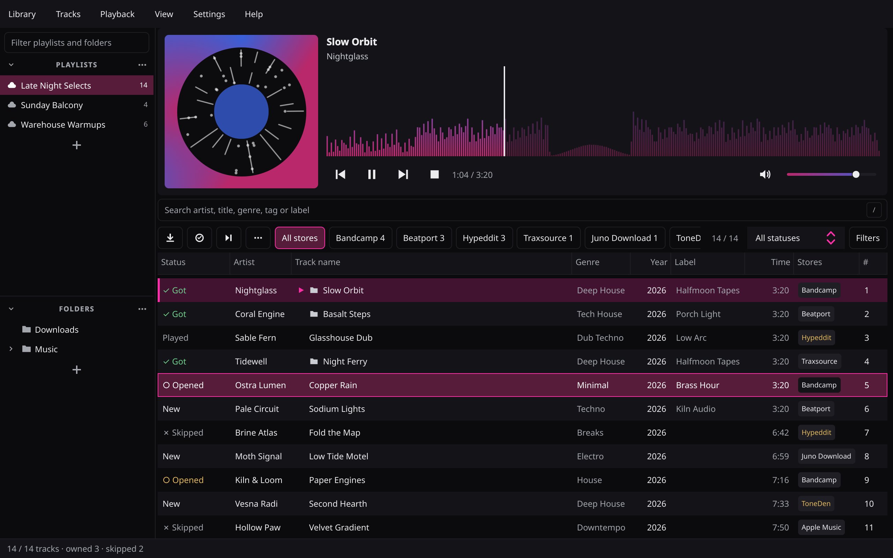
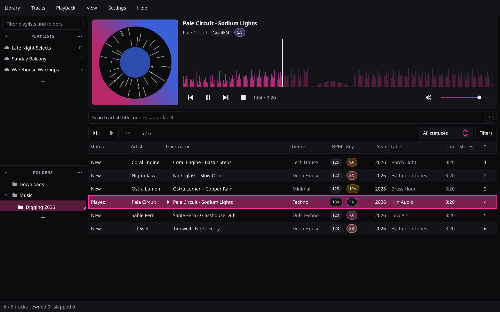

# dj-digger

Turn a SoundCloud playlist into a shortlist for your next set. Listen through the tracks, mark what you own or want to skip, and follow the artist’s download or store links. The desktop app remembers those decisions across playlists and can match tracks to music you already have on disk. Your library stays on your computer.

[Download dj-digger](https://djdigger.app/download/) · [Desktop tour](https://djdigger.app/app/) · [Browser extension](https://djdigger.app/extension/) · [Polska strona](https://djdigger.app/pl/)

<picture>
  <source srcset="docs/screenshots/desktop-player.png">
  
</picture>

## Install the desktop app

| Platform | Get started |
| --- | --- |
| Windows 10 (1809+) or 11, Intel or AMD x64 | Download the Windows installer. [Windows setup](docs/installation.md#windows) |
| macOS 15+, Apple Silicon or Intel | Download the disk image for your processor. [Mac setup](docs/installation.md#mac) |
| Linux | Run the install command for Linux. [Linux setup](docs/installation.md#linux) |

The [official download page](https://djdigger.app/download/) lists installers, checksums and the Linux command. Windows and macOS builds are unsigned previews. The installation guide explains the first-launch prompts. Upgrading an older Python installation? Start with [package-name migration](docs/workflows.md#upgrade-from-the-old-package-name).

## Dig your first playlist

1. **Import.** Press `A` and paste a SoundCloud playlist link. You can also collect likes, reposts, an artist’s uploads or a single track. Sign in to SoundCloud for your own private playlists.
2. **Listen.** Select a row and press `Enter` to play it. `Space` pauses or resumes the loaded track. Click the waveform to seek, or use `N` and `P` to move through the visible tracks.
3. **Decide.** Press `G` on a SoundCloud track you own or `K` to skip it. Press `H` to hide handled tracks. Use `/` to search or pick a store filter to focus on one shop. A playlist refresh brings new arrivals to the top.
4. **Get the file.** Press `O` to open a saved link or `D` for an available artist download. **Add to store carts…** can prepare exact Bandcamp and Beatport matches in your browser. You review the cart and complete checkout.

**In the source checkout**, right-click selected tracks and choose **Send to → Create playlist from selection…** to keep a shortlist in table order. A local playlist can mix downloaded files with SoundCloud tracks. **Find in** searches a single track by artist and title. Import **Daily Drops** or **Weekly Wave** to keep a dated snapshot of a mix before SoundCloud changes it. The [workflow guide](docs/workflows.md) covers playlist sync, column sizing and export options in the source checkout.

## Work with local music

Open a music folder in the sidebar to play files, inspect their BPM and key, or analyze a selection. **Edit BPM / key…** saves your corrections in the library. To take tracks to a gig, select the files, choose **Export audio…**, pick your target decks and review what will be copied or converted. Copying to a new folder preserves your originals.

<picture>
  <source srcset="docs/screenshots/desktop-local-library.png">
  
</picture>

## Connect your browser

The optional extension imports tracks from SoundCloud pages, controls desktop playback and handles supported gates, carts and SoundCloud sign-in in your own browser. A public playlist link can also be pasted directly into the desktop app. See the [connection instructions](docs/installation.md#connect-your-browser) and [extension privacy policy](https://github.com/fbialogrecki/dj-digger/blob/main/PRIVACY.md).

## Use the command line

Install the Python package with `uv tool install dj-sc-digger` for the headless CLI. Close the desktop app first when using the same library. Replace the example SoundCloud URL with your own.

```bash
# Save a playlist to the library and export its links as JSON
dj-digger https://soundcloud.com/artist/sets/playlist -o playlist.json

# Inspect the saved summary without opening browser tabs
dj-digger open playlist.json --no-open

# Export the first 20 liked tracks as CSV
dj-digger https://soundcloud.com/artist/likes -n 20 -f csv -o likes.csv
```

For the desktop from a source checkout, use Python 3.12+ and install FFmpeg and ffprobe on your PATH.

```bash
uv run --extra gui --extra analyze dj-digger-gui
```

## Guides and project links

- **Using the app** — [Playlist, download and local-file workflows](docs/workflows.md), [installation and updates](docs/installation.md).
- **On the website** — [djdigger.app](https://djdigger.app/) has a visual tour, an [FAQ](https://djdigger.app/faq/) and guides to [finding a track’s store link](https://djdigger.app/guides/where-to-buy-soundcloud-tracks/) and [taking SoundCloud finds into rekordbox](https://djdigger.app/guides/soundcloud-to-rekordbox/).
- **Development** — [Project specification](PROJECT_SPECIFICATION.md), [architecture](docs/architecture.md), [website source](site/README.md) and [changelog](CHANGELOG.md).
- **Code graph** — [Explore the interactive Graphify graph](https://djdigger.app/graph/) or [download the JSON](https://djdigger.app/graph/graph.json). This snapshot maps the [source commit](https://github.com/fbialogrecki/dj-digger/commit/4bed67ac6cb465a743254edbf5e692883db8066c). See the [graph notes](docs/graph-notes.md) for scope.
- **Distribution** — [GitHub Releases](https://github.com/fbialogrecki/dj-digger/releases), [dj-sc-digger on PyPI](https://pypi.org/project/dj-sc-digger/), [Apache 2.0 license](LICENSE).
